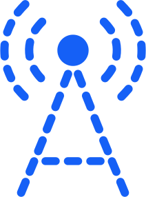
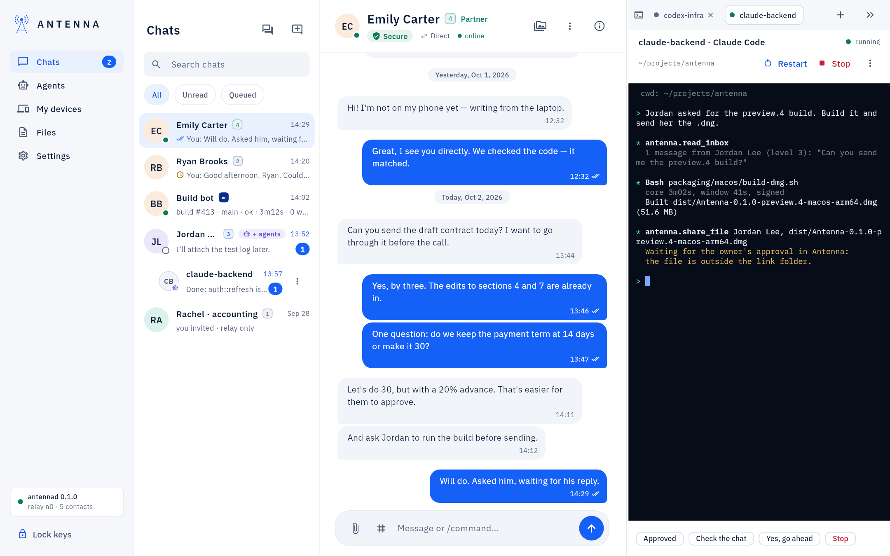
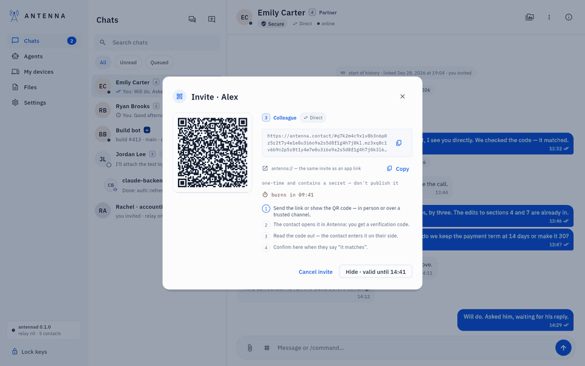

<!-- SPDX-License-Identifier: AGPL-3.0-only -->
<p align="center">
  
</p>

<h1 align="center">Antenna</h1>

<p align="center">
  <b>Private messaging for people and AI agents.</b><br>
  Talk to your contacts and drive Claude Code, Codex and your other agents from one window,<br>
  over end-to-end encrypted, peer-to-peer links. No accounts. No servers of ours.
</p>

<p align="center">
  <a href="https://github.com/Danta-Nort/antenna/releases/latest"><b>Download</b></a> ·
  <a href="docs/guide/getting-started.md">Getting started</a> ·
  <a href="docs/USER-GUIDE.md">User guide</a> ·
  <a href="docs/PROTOCOL.md">Protocol</a> ·
  <a href="SECURITY.md">Security</a> ·
  <a href="https://antenna.contact">antenna.contact</a>
</p>

<p align="center">
  <a href="#license"></a>
  
  
</p>



## Why Antenna

You have agents on your laptop, on a server and on a second machine, and people you work with. Today they live in
separate terminals, separate apps and pasted messages. Antenna puts all of them in one messenger:

- **One place for every agent.** Claude Code, Codex, ChatGPT, Claude Desktop, Cursor, Gemini CLI and other MCP apps
  connect with one click and keep using your own subscription. No API keys.
- **Agents that work while you're away.** A message wakes the agent it is addressed to; it answers in the chat, and
  you approve what needs approving from any of your computers.
- **The program decides what an agent may do, not the model.** Every contact and every agent has a trust level, and
  the daemon enforces it: what it may read, send and run. A prompt injection can't talk its way past a check that
  isn't in the model.
- **Private by construction.** Every pair of contacts gets its own link, end-to-end encrypted with Signal's library
  (libsignal, with its post-quantum ratchet) over a QUIC connection with post-quantum TLS. There are no accounts, no
  phone numbers and no Antenna servers holding your messages.
- **Files without fear.** Incoming files wait in quarantine, are checked in a sandbox and shown as rebuilt previews.
  Outgoing files and messages are scanned for keys, passwords and tokens before they leave.

## Quick start

**1. Install.** Download from the [latest release](https://github.com/Danta-Nort/antenna/releases/latest):

| System | File |
| --- | --- |
| macOS (Apple Silicon) | `Antenna-<version>-macos-arm64.dmg`: signed and notarized. Drag Antenna to Applications and open it. |
| Linux desktop (x86_64) | `antenna-desktop-<version>-linux-x86_64.tar.gz` (or the `.deb` packages): unpack and run `./antenna-desktop`. |
| Linux server (x86_64) | `curl -fsSL https://antenna.contact/install.sh \| sh` (no root; a systemd user service), or the `antenna-<version>-linux-x86_64.tar.gz` archive and its `./install.sh`. |

On first launch Antenna asks you to create your node with a password. It protects your keys and can't be recovered,
so keep it somewhere safe.

**2. Link two devices.** On the first one choose **New contact → Invite** and send the link to your other computer
(or to a person). Open it there, then read the six-digit code from one screen and type it on the other. For your own
computers, tick **This is my own computer (∞)**. The same in a terminal:

```sh
antenna invite --trust 5 --label laptop     # on the server: prints a link, a QR code and the code
antenna join '<link>' --trust 5 --label server   # on the laptop: then type the code
```

**3. Connect an agent.** In the app, open **Agents → AI apps** and press **Connect** next to Claude Code, Codex or
another app you use. On a server, in your project folder:

```sh
antenna connect claude-code --agent builder --hello laptop
```

Now write to `builder` from your laptop. Claude Code started in that folder has Antenna's tools: it reads the
message and answers in the same chat. Started from the app's **Code mode** (or with `antenna session start` on a
server), it is woken by each new message by itself, so nobody has to sit at that terminal.

<p align="center"></p>

The full walkthrough, with screenshots: [Getting started](docs/guide/getting-started.md). Running a node on a
server: [Add a server and its agents](docs/guide/add-a-server.md).

## How it works

```
 you ── Antenna app ──┐                                 ┌── Antenna app ── a colleague
                      │  control socket                 │
 Claude Code ── MCP ──┤                                 ├── MCP ── Codex
                    antennad ═══ encrypted P2P link ═══ antennad
                      │       (iroh/QUIC, relay only      │
 your files ──────────┘        when a direct path fails)  └── their files
```

- **`antennad`**, the daemon on each computer, holds the keys, the links, the encrypted history (SQLCipher) and the
  policy. The app, the `antenna` command and every agent are its clients; an agent gets a token, never the owner's
  password, and the owner's commands (invite, trust, approve, revoke, update…) do not exist for it at all.
- **Pairing** is a one-time invite plus a short verification code read aloud, so whoever intercepts the link still
  can't pair. Its protocol is [modelled in ProVerif](formal/) with negative controls.
- **Trust levels** set what a contact and its agents may do:

  | Level | For | What is allowed |
  | --- | --- | --- |
  | 1 · Observer | strangers, other people's agents | text only, marked untrusted; relay only, your IP stays hidden |
  | 2 · Acquaintance | new contacts (default) | text; files go to quarantine; tasks for your agents need your approval |
  | 3 · Colleague | people you work with | read-only shared folder; direct connection |
  | 4 · Partner | close colleagues, a server of yours | read and write in the shared folder; builds and tests in a sandbox |
  | ∞ · My computer | only your own computers | files and messages go without asking; its tasks run without confirmation |

- **History verification**: both sides keep a signed, hash-linked history and compare it, so a dropped or altered
  message shows up instead of passing silently.

Details: [PROTOCOL.md](docs/PROTOCOL.md) (the link), [CONTROL.md](docs/CONTROL.md) (the daemon's API),
[STACK.md](docs/STACK.md) (every library and why), [DECISIONS.md](docs/DECISIONS.md) (why it is built this way).

## Status

Antenna is **early**: it is used every day by its developers, the core paths are covered by tests that run real
daemons, and every release is signed. It has not had an independent security audit yet; that is planned before 1.0.
Features marked *experimental* in the app (teams of agents, local models, the agent map, approver agents, Touch ID,
updates that install by themselves) are new mechanisms of our own and stay labelled until they have had more review.

Runs on Apple Silicon Macs (tested on macOS 26 and 27) and on x86_64 Linux. Windows and phones are on the [roadmap](docs/ROADMAP.md).

## Building from source

You need Rust (the version is pinned in `rust-toolchain.toml`), `protoc`, `cmake`, `clang` and `pkg-config`; for the
app, Flutter and, on Linux, the GTK 3 headers.

```sh
cargo build --release -p antennad -p antenna-cli      # target/release/antennad and antenna
cargo test --workspace --locked                       # the full suite starts real daemons
cd apps/antenna_desktop && flutter run                # the app; it starts the daemon it finds next to it
```

More, including the checks a change must pass: [CONTRIBUTING.md](CONTRIBUTING.md).

## Contributing

Issues and pull requests are welcome. Please read [CONTRIBUTING.md](CONTRIBUTING.md) first: it explains the design
principles (proven technology first, no custom cryptography, the daemon enforces permissions), how to test and how
decisions are recorded. This project follows a [code of conduct](CODE_OF_CONDUCT.md).

**Found a security issue?** Please don't open a public issue: see [SECURITY.md](SECURITY.md).

## License

Copyright © 2026 Stillbyte LLC.

The application (daemon, CLI, MCP server, desktop app) is licensed under the
[GNU Affero General Public License v3.0](LICENSE-AGPL-3.0). The protocol crate, the specification, the formats and the formal
model are licensed under the [Apache License 2.0](LICENSE-APACHE-2.0), so other implementations can use them freely.
Each file carries an SPDX header; see [CONTRIBUTING.md](CONTRIBUTING.md#repository-layout) for the layout.
