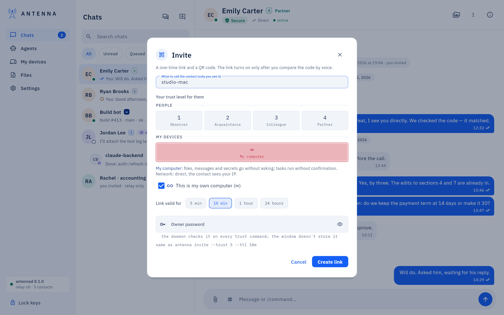
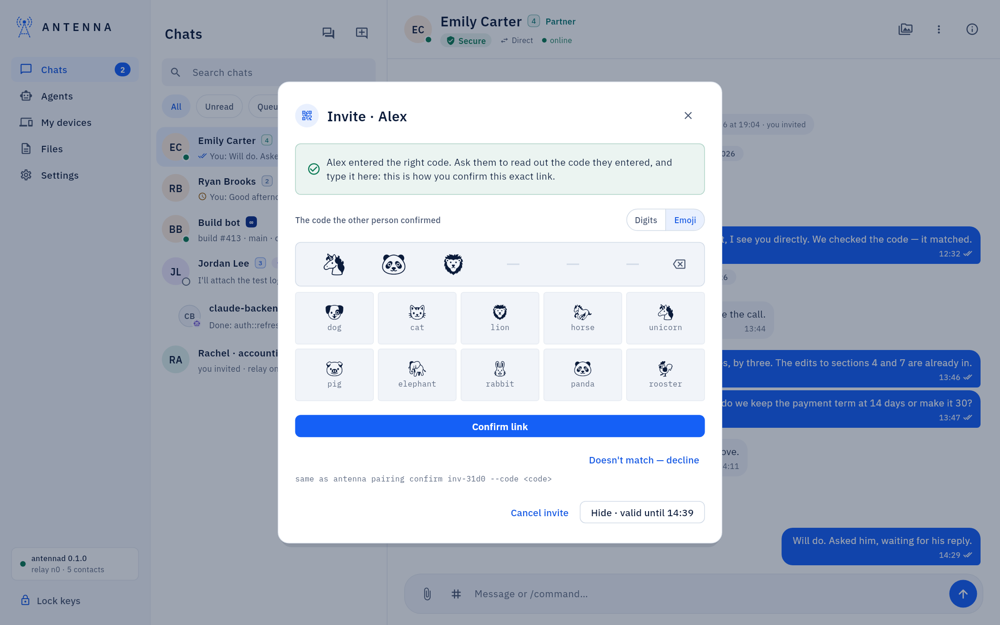
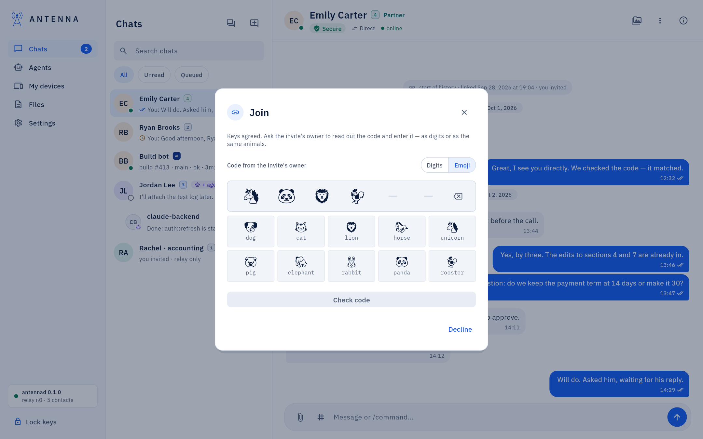
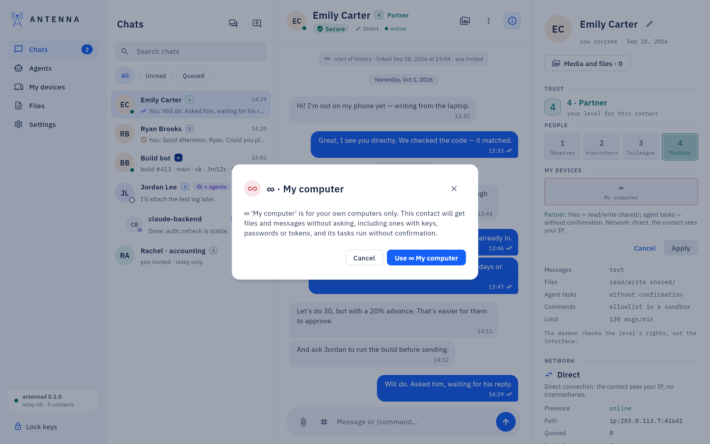
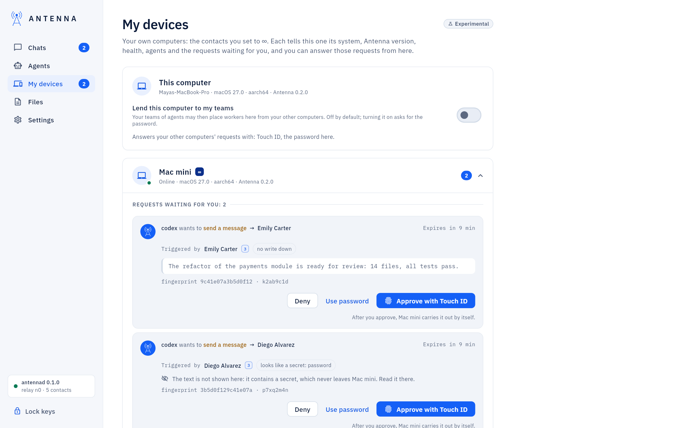
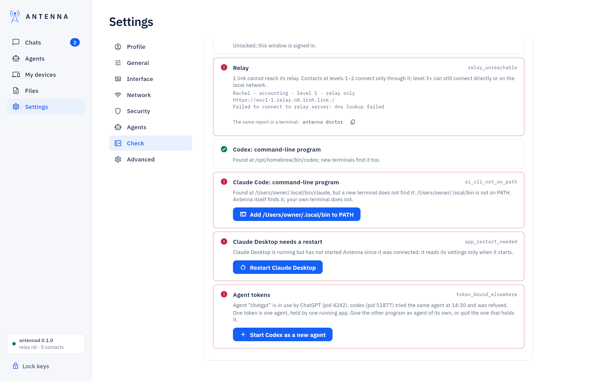
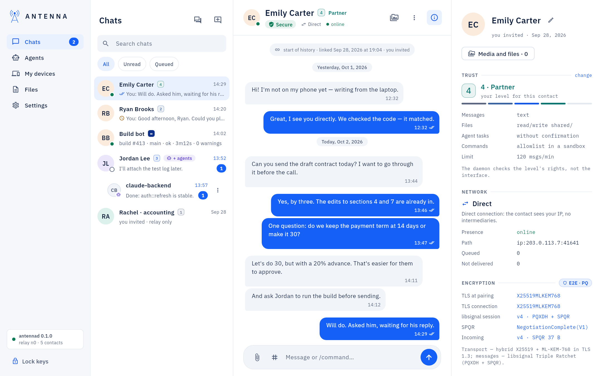

<!-- SPDX-License-Identifier: AGPL-3.0-only -->
# Add a server and its agents

A server, or any Linux computer that stays on, can run its own Antenna and its own agents and work as one more of
your computers, next to your Mac. This page goes from an empty server to an agent there that your Mac and its agents
can talk to, with the commands to type at each step.

*How to read the commands.* Copy them as they are, except words in angle brackets: those are yours to fill in, without
the brackets. `<version>` is the release you downloaded (for example `0.1.0`), `<link>` an invite link, `<name>` an
agent's name, `<project folder>` a folder on the server. The examples call the server `build-server` on the Mac, and
the Mac `mac` on the server: use any names you like, as long as you use the same ones throughout.

*What you need.* A Linux server on x86-64 that you can log in to with ssh (there is no build for ARM servers yet),
and Antenna on your Mac ([Getting started](getting-started.md)).

## 1. Install Antenna on the server

Both ways below install the same two programs: `antennad`, Antenna's service (it keeps the keys, holds the links and
checks every permission), and `antenna`, the command line. Both run `antennad` as a *systemd user service*: it runs
as your user, not as root, starts by itself and restarts after a failure.

*The package (Ubuntu or Fedora).* Download `antenna-<version>-linux-x86_64.deb` (or the `.rpm`) from the release
page, then:

```
sudo apt install ./antenna-<version>-linux-x86_64.deb
systemctl --user enable --now antennad
```

On Fedora the first line is `sudo dnf install ./antenna-<version>-linux-x86_64.rpm`. The package puts the programs in
`/opt/antenna` (with `antenna` and `antennad` in `/usr/bin`); the second line turns its service on. A server needs only
this `antenna` package: `antenna-desktop` is the window, for a Linux desktop. A package install is updated with your
package manager, the way you installed it; `antenna update` refuses and says so.

*One line (any x86-64 Linux, no root needed).* The same archive, found, downloaded and checked for you:

```
curl -fsSL https://antenna.contact/install.sh | sh
```

It reads the newest release from the signed release manifest, checks the archive's SHA-256 against it, runs the
archive's `install.sh` (below; pass its options after `sh -s --`, for example `| sh -s -- --no-systemd`), and then
has the installed `antenna` verify the manifest's signature with the release keys built into it.

*The archive (any x86-64 Linux, no root needed).* Download `antenna-<version>-linux-x86_64.tar.gz`, then:

```
tar xzf antenna-<version>-linux-x86_64.tar.gz
cd antenna-<version>-linux-x86_64
./install.sh
```

`install.sh` puts the programs in `~/.local/bin`, writes the service to `~/.config/systemd/user/antennad.service`,
starts it, and runs `antenna init` for you (step 2). If it says `~/.local/bin` is not in your PATH, add the line it
prints to `~/.profile` and log in again. `./install.sh --help` lists its options. An archive install is updated with
`antenna update` ([Updates](updates.md)).

*Keep it running when you log out.* A user service stops when you log out of the server, unless your user is allowed
to "linger". Run this once:

```
sudo loginctl enable-linger $USER
```

To see whether the service runs: `systemctl --user status antennad`. Its log: `journalctl --user -u antennad`.

## 2. Create the node: `antenna init`

The archive's `install.sh` has already done this step. After a package install, run it yourself:

```
antenna init
```

It asks for an *owner password*, twice, at least 8 characters. The password encrypts the server's keys on its disk,
and Antenna asks for it for everything only you may do there: an invite, a trust level, an agent's token, an approval.
An agent never gets it. It cannot be recovered: if you lose it, you create the node and every link again. Each of your
computers has its own password.

After every reboot of the server its keys are locked: the service runs, but its links stay silent until you unlock it.

```
antenna unlock
```

Commands that change trust (`invite`, `join`, `trust`, `agent add`) ask for the password every time. Other owner
commands, such as `antenna contacts`, ask for it once: `antenna login` keeps this terminal signed in for 15 minutes
after its last command, like `sudo`. `antenna status` shows the state (`locked` or `unlocked`), the version and the
relay.

## 3. Pair the server with your Mac

Two of your computers are linked the way you link with a person: a one-time invite on one side, a join on the other,
and a *verification code* that both sides must agree on. The code is what keeps the link safe: someone who saw the
invite link cannot use it without the code. Either side can invite. Tick ∞ right away, as below: step 4 explains why.

### The Mac invites, the server joins

1. On the Mac: **New contact → Invite**. Name the contact (`build-server`), tick **This is my own computer (∞)**,
   enter your Mac's password and press **Create link**. Copy the link with the copy button next to it.

   

2. On the server, paste the link between single quotes (it contains a `#`, which the shell would otherwise cut off):

   ```
   antenna join '<link>' --trust 5 --label mac
   ```

   It asks you to confirm level 5 (answer `y`) and for the server's password. Once it reaches the Mac, the Mac shows
   a code of 6 digits (or the same code as 6 animals), and the server asks you to enter it.
3. Type the code from the Mac's screen into the server's terminal. The Mac then says the contact entered the right
   code: press **The contact confirmed — codes match**. The server prints a line that starts with
   `linked with mac (trust 5, direct)`. If the server refuses the code, check it digit by digit; once the invite has
   burned, create a new one.

   

### The server invites, the Mac joins

1. On the server:

   ```
   antenna invite --trust 5 --label mac
   ```

   It asks you to confirm level 5 and for the password, then prints the link, the same link for the app and a QR
   code, and waits. The link is valid for 10 minutes; `--ttl 1h` gives you an hour.
2. On the Mac: **New contact → Join**. Paste the link, name the contact (`build-server`), tick
   **This is my own computer (∞)**, enter your password and press **Join**. The server's terminal now shows the
   code: enter it on the Mac, as digits or by tapping the animals.

   

3. The server says the other side typed the code correctly: type `yes`.

### Without a window on either side

Between two servers, or with a Mac where you use only the command line, both sides type commands: on one,
`antenna invite --trust 5 --label <other computer>`; on the other, `antenna join '<link>' --trust 5 --label <other
computer>`. Type the code the inviting side shows into the joining side, then `yes` on the inviting side.

## 4. Set ∞ on both sides

∞, shown as **My computer** (trust level 5), is the level for your own computers only. Each computer keeps its own
level for the other: the Mac's level for the server is set on the Mac, the server's level for the Mac is set on the
server. Your server counts as *your computer*, in **My devices** and on the agent map, only when *both* have each
other at ∞; until then it is an ordinary contact.

If you ticked **This is my own computer (∞)** and used `--trust 5` in step 3, this is done. Otherwise:

- *On the Mac:* open the server's chat, then its contact card (the ⓘ button at the top right). Next to **Trust**,
  press **change**, choose **My computer** under **My devices**, accept the warning with **Use ∞ My computer**, then
  **Apply** and your password.

  

- *On the server:*

  ```
  antenna trust mac 5
  ```

  It asks you to confirm (`y`) and for the password; in a script, add `--yes`.

To check: on the server, `antenna contacts` lists `mac` with `trust 5`; on the Mac, the server has the ∞ badge next to
its name.

What ∞ means: files and messages go between the two computers without asking, including ones with keys, passwords or
tokens, and tasks from one run on the other without confirmation. Never set ∞ for someone else's computer. All the
levels: [Contacts and trust](contacts.md#trust-levels).

## 5. Add an agent on the server

An agent is a program with a model (Claude Code, Codex, any app that speaks MCP, a script of your own) that reads
and writes through Antenna under its own name, with its own token. The token stays on the server: Antenna writes it to
a file only you can read, and the agent's settings name that file, never the token. Two ways, depending on how the
agent runs.

### An app that speaks MCP

```
antenna agent add <name> --local-level 5 --links mac --token-file
```

- `<name>`: the agent's name, in Latin letters, digits, `.`, `-` or `_` (for example `builder`). Your contacts see
  it, and it is how your Mac's agents address it.
- `--local-level`: what the agent may see on the server outside Antenna. `5` is for an agent that works in your own
  projects: its replies to contacts below ∞ then wait for your approval (your Mac, at ∞, needs none). `0` is a
  "front desk" that sees nothing but its link folders.
- `--links mac`: the contacts it may use, separated by commas. Without this option it may use all of them.
- `--token-file`: write the token to a file and print only the file's path, for example
  `/home/<you>/.local/share/antenna/agents/<name>.token`.

Give the app that path, never the token. The entry in an app's MCP settings:

```
{"command": "antenna", "args": ["mcp", "--token-file", "<token file>"]}
```

For Claude Code, the same entry as one command:

```
claude mcp add antenna --scope user -- antenna mcp --token-file <token file>
```

For Codex, in `~/.codex/config.toml`:

```
[mcp_servers.antenna]
command = "antenna"
args = ["mcp", "--token-file", "<token file>"]
```

The app must start `antenna mcp` itself, directly, not through `npx` or `sh -c`: that is how Antenna recognizes the
agent's processes. If the app cannot find `antenna`, write its full path instead (`command -v antenna` prints it).

*Claude Code in one project folder: a shortcut.* Run this in the folder. It creates the agent and its token file,
shows Claude Code's own command that adds Antenna for this folder only, and runs it after your yes; `--hello mac`
makes the agent say hello, so its chat appears on the Mac at once:

```
cd <project folder>
antenna connect claude-code --agent <name> --links mac --hello mac
```

For Codex, `antenna connect codex --agent <name> --links mac` prints the command line to start Codex with.

*Set the folder up in the same step.* What the agent needs from you (its instruction files, a git name and email,
Claude Code's permission rules) is set by you when you create it, never sent to it later as a message, which its
runtime would rightly refuse. Add the choices to the same command, for example
`--dir <project folder> --instructions --allow antenna-tools` to `agent add`, or `--instructions --allow
antenna-tools` to `connect`. Antenna shows exactly what it will write and asks first. What each choice does:
[Add an agent on this computer](add-an-agent.md#set-up-this-folder).

### A Claude Code or Codex session that Antenna wakes

*Experimental.* An interactive Claude Code or Codex session waits for someone to type once it finishes a turn.
Started through Antenna inside tmux, it is woken the way Code mode wakes an agent in the window: when a message for it
arrives, Antenna types one built-in line at its empty prompt. Never a contact's text, never into a question it asks,
at most one line every 30 seconds.

tmux must be installed (`sudo apt install tmux`, or `sudo dnf install tmux`). The agent needs a token file first: the
`antenna agent add … --token-file` above, or `antenna connect`. Then:

```
antenna session start <name> --dir <project folder>
antenna session attach <name>
antenna session list
```

- `start` runs Claude Code in the folder (add `--cli codex` for Codex), connected to Antenna for this session only:
  your own Claude Code and Codex settings are not changed. `--resume` continues the agent's last session; anything
  after `--` goes to Claude Code or Codex itself.
- `attach` brings the session into this terminal: answer the program's own first questions there (whether it trusts
  the folder, for example), and look in whenever you like. `Ctrl-b d` leaves it running.
- `list` shows what runs, its state, whether wake is on, and the last line Antenna typed.
- `antenna session wake <name> off` stops the automatic lines; `antenna session stop <name>` ends the session.

Antenna runs its own tmux server for these sessions; your own tmux is not touched.

## 6. See the server in My devices and on the map

On the Mac, **My devices** now has a card for the server: online or when it was last heard from, its system and
Antenna version, its **Health** (the problems its own checks see, as `antenna doctor` there would say), its
**Agents** (each with the program it runs as and whether it is connected), and the requests waiting for your approval
there, which you can answer from the Mac. The server sends this report when something changes and at least once a
minute; until the first one arrives, the card says "Not heard from yet: it tells this computer about itself once they
connect."



Answering the server's requests from the Mac needs the server to accept the Mac's approvals, once. On the server:

```
antenna devices confirm mac
```

On the agent map, **Agents → Map**, the server is among your other computers, with the agents it reports. More:
[My devices](my-devices.md) and [Agent map](agent-map.md).

## 7. Connect an agent on the Mac to an agent on the server

On **Agents → Map**, draw a line from an agent on the Mac to an agent on the server, or use the agent's menu →
**Connect to…**. A dialog says what changes on each side; press **Connect** and enter your password. The server's
side becomes an approval request on the server: approve it with **Approve now** in the same dialog, in **My devices**
on the server's card, or on the server itself (`antenna approvals`, then `antenna approve <id>`). From then on,
messages the Mac agent sends without naming a contact go to the server agent, and back.

From the Mac's terminal, the same line:

```
antenna agent connect <mac agent> build-server --agent <server agent>
```

Step by step, with every choice in the dialog: [Connect two agents](connect-agents.md).

## 8. If something does not work

*The server shows offline:* **Offline** on its card in **My devices**, "offline" under its name in the chat, and
messages to it with a clock (they are queued and go out by themselves when it is back). On the server:

```
systemctl --user status antennad
antenna status
antenna doctor
```

- The service does not run: `systemctl --user enable --now antennad`, and read its log with
  `journalctl --user -u antennad`. If it stops each time you log out, the `enable-linger` line of step 1 is missing.
  If systemd says the user session is not available, run that line and log in again.
- `antenna status` says `state: locked`: the server has rebooted. Run `antenna unlock`.
- `antenna doctor` lists what it found, each problem with what to do; it changes nothing by itself. On the Mac,
  **Settings → Check** does the same for the Mac's side.

*The relay.* Each link has a *relay*: a server that passes on encrypted traffic it cannot read, used when the two
computers cannot connect directly. By default it is the public n0 relay
(`antenna status` says `relay: n0`). When a link cannot reach its relay, `antenna doctor` names the contact, the relay
and the error, and **Settings → Check** on the Mac says how many links cannot reach their relay. Check the server's
internet connection (and, for a relay of your own, that it runs): Antenna keeps retrying and reconnects by itself once
the relay answers. A link at ∞ can still connect directly meanwhile, where the two computers can reach each other. A
relay of your own is chosen when `antennad` starts (`./install.sh --relay <url>` for an archive install).



*A link that is not direct.* **Direct** under the server's name in the chat means the link *may* connect directly
(contacts at levels 3 to 5, so also ∞); it does not say which way it goes right now. The **Path** row in the contact
card does: an `ip:` line is a direct path, a `relay:` line a path through the relay. With only `relay:` lines the link
works, through the relay: it can be slower, and the relay sees both computers' IP addresses, never the content.



- Direct paths use UDP. If the server has a firewall, or your hosting provider filters its traffic, check that UDP
  is let through; otherwise the link stays on the relay.
- Levels 1 and 2 always go through the relay, by design: check that both sides have each other at ∞ (step 4).
- On the same local network, `antenna lan on` (on each computer, with its password) lets them find each other without
  the internet or the relay: [Settings → Network](settings.md#network).

Every message the window and the command line show, with what to do: [USER-GUIDE: "If something does not
work"](../USER-GUIDE.md#if-something-does-not-work).
