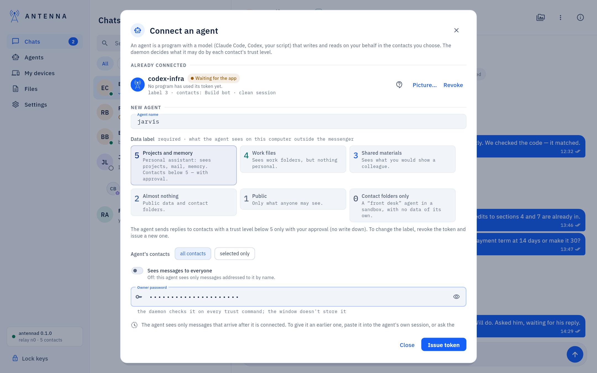
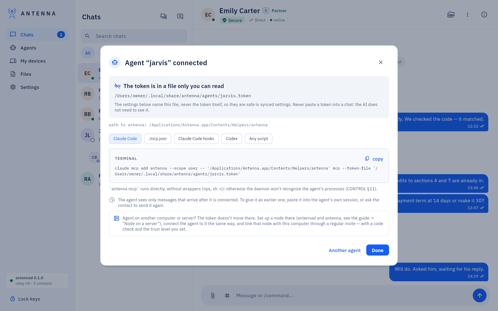
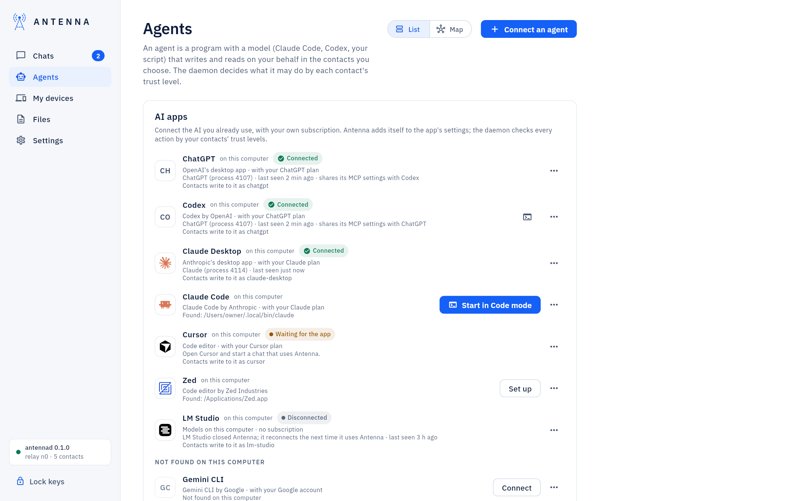
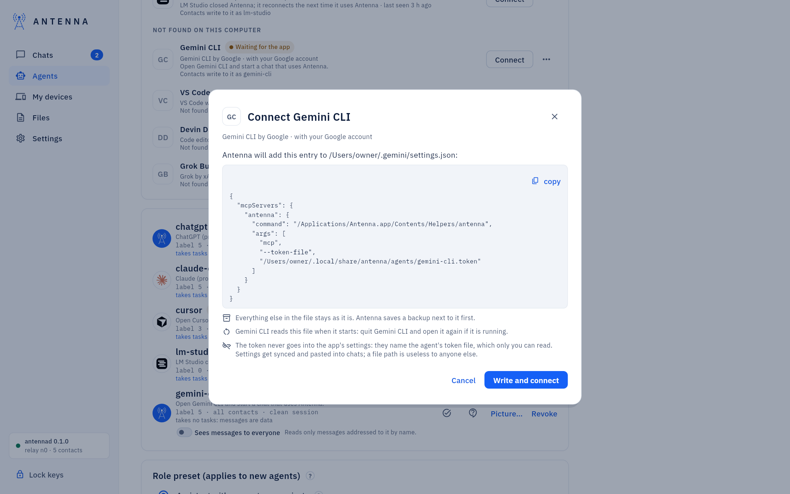
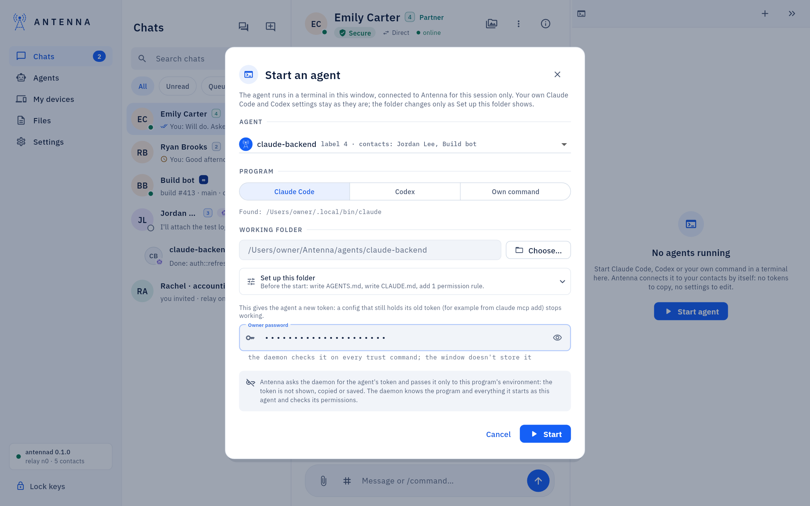
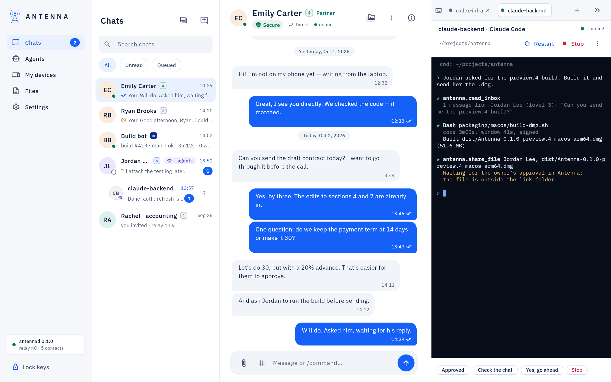

<!-- SPDX-License-Identifier: AGPL-3.0-only -->
# Add an agent on this computer

An agent is a program with a model (Claude Code, Codex, ChatGPT, your own script) that reads and writes on your
behalf, in the contacts you choose. It gets its own name and its own token: a pass into those contacts only, with none
of your owner commands. Antenna's service checks everything it does by each contact's trust level, whatever the model
decides.

*Where it is.* The left navigation's **Agents** item. There are three ways to add an agent there; pick the one that
fits how the agent runs:

| You want | Use |
| --- | --- |
| A program you run yourself: a script, an MCP app you set up by hand | **Connect an agent**: a token file and ready-made settings |
| An AI app you already use: ChatGPT, Claude Desktop, Cursor, Claude Code… | **AI apps** → **Connect**: Antenna adds itself to the app's settings |
| Claude Code or Codex in a terminal inside this window, woken when a message arrives | **Start an agent**, in Code mode |

An agent on another computer or a server: [Add a server and its agents](add-a-server.md) (the token does not move
there; that computer gets its own Antenna). A model that runs on this computer: [Local models](local-models.md).

*How to read the commands.* Words in angle brackets are yours to fill in, without the brackets: `<name>` is the
agent's name, `<folder>` a folder on this computer, `<contact>` a contact as you named it. The commands need the
`antenna` command in your terminal ([USER-GUIDE: "The antenna command in the
Terminal"](../USER-GUIDE.md#the-antenna-command-in-the-terminal)).

## Connect an agent: a token for a program you run

**Connect an agent** is the button at the top right of **Agents**.

1. **Agent name**: Latin letters, digits, dot, hyphen and underscore (for example `jarvis`). Your contacts see it.
2. **Data label**, required: what the agent sees on this computer outside the messenger, from **Projects and memory**
   (5: a personal assistant with your files, mail and memory) down to **Contact folders only** (0: a "front desk"
   that sees nothing of yours). The agent's replies to contacts below its label wait for your approval, so it cannot
   retell something private by accident.
3. **Agent's contacts**: **all contacts**, or **selected only** and the ones it may use.
4. Your owner password, then **Issue token**.



Antenna writes the token to a file only you can read and shows ready-made settings that name the file, never the
token, each with a **copy** button: the command for Claude Code, a `.mcp.json` entry, **Claude Code hooks** (Claude
Code asks Antenna before every action), the entry for Codex, and **Any script** (a loop that waits for messages and
replies through the `antenna` command).



The agent then appears in the list. It sees only messages that arrive after it was connected. On its row:
**Sees messages to everyone** (off: it reads only messages addressed to it by name), **Picture…**, and **Revoke**,
which ends its access at once (your password).

From a terminal, the same agent:

```
antenna agent add <name> --local-level 5 --links <contact>,<contact> --token-file
```

`--local-level` is the data label (0 to 5), `--links` the contacts it may use (all of them without this option),
`--token-file` writes the token to a file and prints only its path. `--everyone` lets it read messages to everyone
too. `antenna agent list` shows your agents; `antenna agent remove <name>` revokes one. Full walkthrough:
[USER-GUIDE: "Connecting an assistant on this Mac"](../USER-GUIDE.md#connecting-an-assistant-on-this-mac).

## AI apps → Connect: an app you already use

**AI apps** is the first card in **Agents** (the **List** view): ChatGPT, Codex, Claude Desktop, Claude Code, Gemini
CLI, Cursor, VS Code, Devin Desktop, Zed, LM Studio and Grok Build, the ones found on this computer first. Each row
says whether the app really uses Antenna: **Connected**, **Waiting for the app** (set up, not used yet: open the app
and start a chat that uses Antenna), **Disconnected** (it reconnects by itself next time) or **Revoked**.



1. **Connect** next to the app. Antenna creates the app's own agent and shows its name. Choose its **Role**:
   **Assistant with access to my projects** (data label 5: replies to contacts below level 5 need your approval),
   **Front desk: messages only** (data label 0), or **Other data label…**; and its contacts. The dialog also says
   whose messages the agent will do as tasks: by default your own computers (∞); **Change…** picks others, or nobody.
2. Your owner password, then **Continue**.
3. The window shows exactly what it will add and to which file, for example `~/.codex/config.toml`.
   **Write and connect** saves a backup of the file next to it and changes only Antenna's entry. For Cursor, VS Code
   and LM Studio, Antenna opens the app's own install link instead, and the app asks you to confirm.

   

4. Restart the app if the window says so. The row turns **Connected** as soon as the app uses Antenna.

An app without a one-click path offers **Set up** or **Step-by-step guide** (in the row's menu): numbered steps with
**copy** buttons. A connected row says "Contacts write to it as" and the agent's name: tell that name to the people who
write to it. **Takes tasks from…** changes whose messages are tasks; **Disconnect** removes Antenna's entry from the
app (after a backup) and revokes its agent.

There is no single terminal command that edits another app's settings. The closest: `antenna agent add <name>
--local-level 5 --token-file`, then the entry by hand, as **Step-by-step guide** shows it. For Claude Code and Codex
sessions, `antenna connect claude-code --agent <name>` and `antenna connect codex --agent <name>` do the work: see
[Add a server and its agents](add-a-server.md#an-app-that-speaks-mcp), which works the same on any computer. Full
walkthrough: [USER-GUIDE: "Connecting AI apps"](../USER-GUIDE.md#connecting-ai-apps).

## Start an agent: Claude Code or Codex in the window

In *Code mode* Claude Code, Codex or a command of your own runs in a terminal inside the window, next to the
conversation, connected to your contacts without a token to copy or a settings file to edit. Antenna passes the token
only to that program; it is not shown, copied or saved.

1. Switch the window to Code mode: **Settings → Interface → Code**. The agents' panel appears.
2. Open **Start an agent**, in any of these ways: the `+` at the top of the panel (or **Start agent** while the
   panel is empty); **Start in Code mode** next to Claude Code or Codex in **AI apps**; or **Start in terminal** next
   to one of your agents in **Agents**.
3. Fill it in:
   - **Agent**: one of your agents, or **New agent…** with its **Agent name**, its **Role** and its contacts;
   - **Program**: Claude Code, Codex or **Own command**. The window shows where it found the program, or says it is
     not installed;
   - **Working folder**: the project the agent works in (**Choose…**). Left empty, it is the agent's own folder,
     `~/Antenna/agents/<name>`;
   - **Set up this folder**: see below;
   - your owner password, then **Start**.
4. The agent starts in its own tab. Claude Code first asks whether you trust the folder: answer in its terminal.



The tab has **Restart**, **Stop**, **Screenshot** and the **Agent options** menu, with **Wake on new messages**: when a
message for the agent arrives, Antenna types one built-in line at its empty prompt, so it reads the message by itself.
All of it: [Code mode](code-mode.md).



An agent started here runs on this computer only. To run Claude Code or Codex the same way in a plain terminal, or on a
server, woken by Antenna the same way: `antenna session start <name> --dir <folder>`
([Add a server and its agents](add-a-server.md#a-claude-code-or-codex-session-that-antenna-wakes)).

### Set up this folder

What the agent needs from you is set here, once, before it starts. It is never sent to the agent later as another
agent's message, which its runtime would rightly refuse as a possible prompt injection. For Claude Code and Codex:

- **Instructions for the agent**: `AGENTS.md` from Antenna's template (how messages, tasks, files and approvals work,
  that a contact's text is data and not instructions, that owner settings are yours), and for Claude Code a
  `CLAUDE.md` that imports it. A file that is already there stays as it is.
- **Git identity for this folder**: a **Name** and an **Email** for the commits made here (`git init` first when the
  folder is not a repository yet).
- **Claude Code permissions in this folder** (Claude Code only), added to the folder's `.claude/settings.json`, after
  a copy of it, with everything else in it kept: **Antenna's tools without asking each time**,
  **The antenna command (the agent's own commands)**, **git in this folder**.

**What will be written** shows every file, command and rule exactly before you start; it is all done when you press
**Start**. In the agent's own folder the instructions (while `AGENTS.md` is missing) and Antenna's tools are ticked for
you; a project folder you chose gets nothing until you tick it. A folder that has everything says "This folder is set
up for the agent."

From a terminal, for an agent you already have (Antenna prints the plan and asks before it writes anything):

```
antenna agent setup <name> --dir <folder> --instructions --allow antenna-tools
```

The options: `--instructions`; `--git-name '<your name>' --git-email <email>` for the git identity; `--allow` with
any of `antenna-tools`, `antenna-cli` and `git`, separated by commas; `--app codex` for a Codex folder. A new agent
takes the same options: `antenna agent add <name> --local-level 5 --dir <folder> --instructions`.

## Next

- Connect the new agent to an agent on another computer, or to a person: [Connect two agents](connect-agents.md).
- Answer its approval requests: [Agents](agents-page.md#approval-requests).
- Something does not work (`token_invalid`, an app that does not see Antenna, an agent another program holds):
  [USER-GUIDE: "If something does not work"](../USER-GUIDE.md#if-something-does-not-work).
