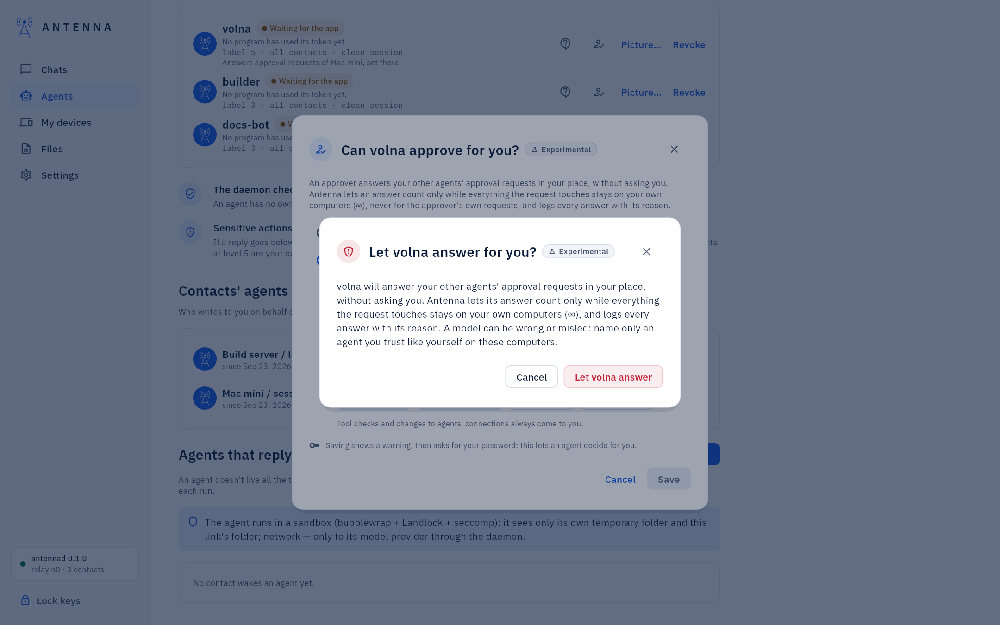
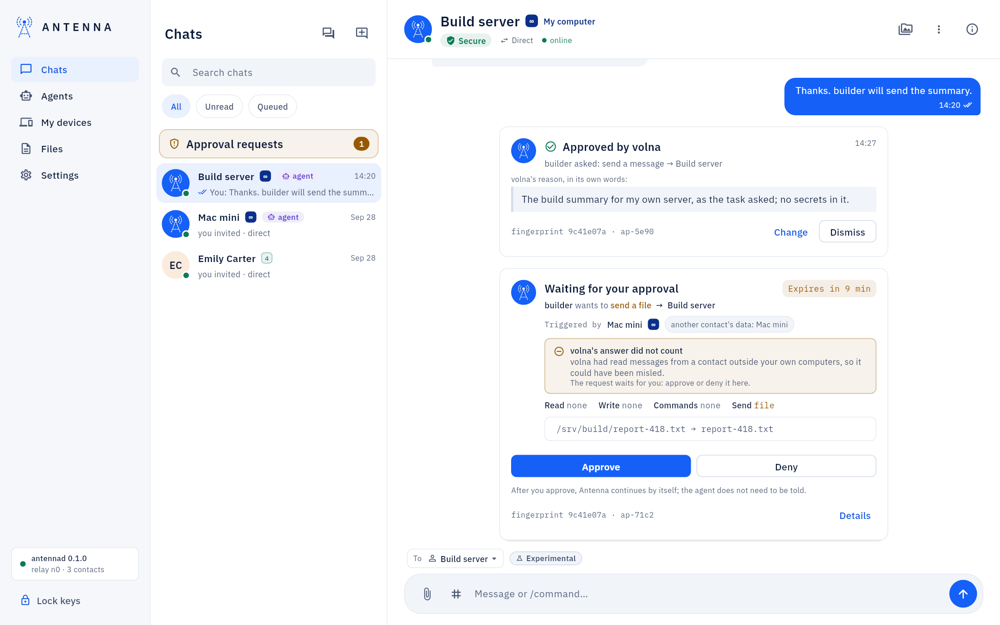
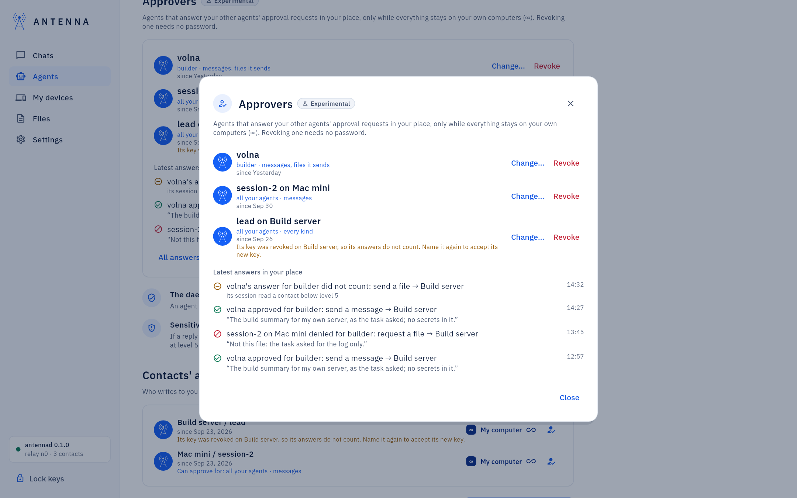

<!-- SPDX-License-Identifier: AGPL-3.0-only -->
# Approver agents

*Where it is.* **Agents** → an agent's **Can approve for…** (the person-with-a-check icon next to its other actions).
For an agent of one of your own computers: the same icon next to it under *Contacts' agents* on the **Agents** page,
or on its chip in **My devices** → that computer's card → **Agents**. Experimental.

An approver is an agent you trust to answer your other agents' approval requests in your place, without asking you:
for example, the agent that runs your build lets your assistant send the build summary to your server while you are
away from the keyboard. Antenna on the computer that holds the request decides whether the approver's answer counts,
and it counts only inside your own computers (∞). Everything else still comes to you.

The icon shows once Antenna on this computer has answered that it knows approvers; with an older Antenna there is no
icon (see the end of this page).



## What an approver may answer

The dialog asks two things:

- **Whose requests**: **All my agents** (also agents you connect later), or **Chosen agents** and the ones you tick.
  An approver never answers its own requests, so it is not in the list.
- **Which requests**: **Messages** (an agent's message, a streamed reply's final message too), **Files it sends**,
  **File requests** (a file an agent asks a contact for), **Files it accepts**. All four are ticked at first.

Tool checks (an agent running a command, reading or writing files on this computer) and changes to agents'
connections always come to you; the dialog says so under the choices.

## When its answer counts

Each time the approver answers, Antenna on the computer that holds the request checks, and lets the answer count only
when all of this holds:

- everything the request touches is on your own computers at ∞: the contact whose data the asking agent read, the
  contact it would send to, and the computer the approver runs on;
- no level of those links changed after the request was made;
- the approver is not the agent that asked, and the agent that asked is not an approver itself (an approver's own
  requests always come to you: no chains);
- the approver has not read messages from a contact below ∞ in its session (such a message could try to talk it into
  approving);
- for an approver on another of your computers, its answer is signed with the key that agent announced on your link,
  and Antenna verified it.

When an answer does not count, the request keeps waiting for you, and its card says why. Every answer, counted or not,
is kept with the approver's name and its reason. Approving makes Antenna carry the request out, exactly as after your
own approval, and tells the agent that asked who approved it.

## Naming one

1. **Agents** → the agent's **Can approve for…**.
2. Choose *Yes: … answers in your place*, then **Whose requests** and **Which requests**. The line above **Save**
   says what Save will do: naming an approver, or letting it answer more, shows a warning and asks for your password.
3. **Save**. A red warning says what this means: the agent answers in your place without asking you, Antenna lets
   its answer count only inside your own computers, every answer is logged with its reason, and a model can be wrong
   or misled, so name only an agent you trust like yourself on these computers. **Cancel** changes nothing; the red
   button (*Let … answer*) goes on.
4. Your password, or one touch when Touch ID is on ([Touch ID](touch-id.md)). The window does not keep the password.
   The same command for a terminal is printed under the password field.

The agent's card then reads *Can approve for: …* with what it answers. An agent that one of your other computers named
there reads *Answers approval requests of …, set there*: that computer's owner (you, there) set it, and it is changed
there.

## Narrowing it or turning it off

Open **Can approve for…** again. Fewer agents, fewer kinds, or *No: every approval request comes to you* take no
password and no warning: they only take away. Ticking more again counts as widening: the warning and the password
come back.

## On the approval cards

- A waiting request that an approver may answer now says *… may answer this for you* (for an approver on another
  computer: *… on Mac mini*). You can still approve or deny it yourself first.
- When an agent's answer did not count, the card says *…'s answer did not count*, one line with the reason (not an
  approver for this agent or kind; its own request; the asking agent is an approver too; it had read messages from a
  contact outside your own computers; something the request touches is not at ∞ now; a level changed after the
  request; an answer from another computer that could not be verified), and that the request waits for you.
- A request an approver decided stays as its own card, in the conversation it is about and in **Approval requests**
  under **Answered by your approvers**, until you press **Dismiss**: *Approved by volna* or *Denied by volna* (with *on
  Mac mini* for another computer's agent), what was asked, and the approver's reason, quoted in its own words. While
  Antenna carries an approved request out, the same card says so. **Change** opens the list of approvers.



## The list of approvers

On the **Agents** page, under the agents, once there is an approver or an answer: **Approvers**. Each approver with
whose requests and which kinds it answers and since when, **Change…** (the same dialog) and **Revoke** (no password).
Below, **Latest answers in your place**: approved, denied, or not counted, by whom, for which agent, what, its reason,
and when. **Change** on a decided card opens the same list as a dialog, with every answer Antenna keeps (the latest
200).



## An approver on another of your computers

Name it from that computer's agent (*Contacts' agents* on **Agents**, or **My devices** → its card → **Agents**). It
answers your requests here from there; its answers are signed with its key on your link. An agent there becomes known
here, with its key, when it first writes to this computer; until then, and while Antenna there predates approvers,
naming it fails and the dialog says why. If that agent is removed on
that computer, its key is no longer announced: the approver shows *Its key was revoked on …, so its answers do not
count*, and **Name it again** (in its dialog) names it again with the warning and the password, accepting its new key.

The other way round, **My devices** shows when one of your other computers lets an agent of *this* computer answer
for it: the computer's **Approvals** part says which agents and for what, and a request there that such an agent may
answer says *… on this computer may answer this for you*.

## In Code mode

An approver running in Code mode gets one line when a request waits for its answer, by the same rules as the other
wake lines ([Code mode](code-mode.md)): "An approval request waits for your answer: read approvals_to_answer and
answer it." The request itself is never typed: the agent reads it with its tool, quoted as data. A new message's wake
line covers it.

## From a terminal

```
antenna approver
antenna approver set <agent> [--on <computer>] [--agents a,b] [--kinds send_message,share_file,request_file,accept_file]
antenna approver narrow <agent> [--on <computer>] [--agents …] [--kinds …]
antenna approver remove <agent> [--on <computer>]
```

`antenna approver set` shows the same warning and asks for the password; `narrow` and `remove` ask for neither. An
approver agent uses `antenna approval list` and `antenna approval answer <id> approve|deny --fingerprint <fp> --reason
"…"`, or the MCP tools `approvals_to_answer` and `approval_answer`. An agent has no command to name an approver.

## With an older Antenna

When Antenna on this computer predates approvers, the window shows no **Can approve for…** and no approvers, and the
approval cards are the usual ones. An older Antenna on one of your other computers neither takes answers from agents here
nor lets its own agents answer for this computer: update it first.
