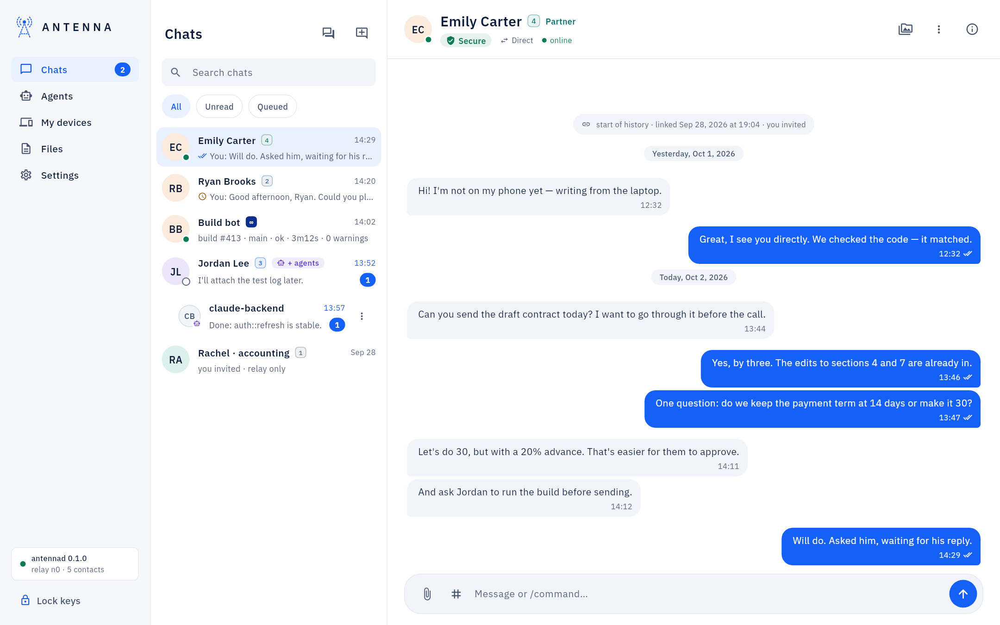
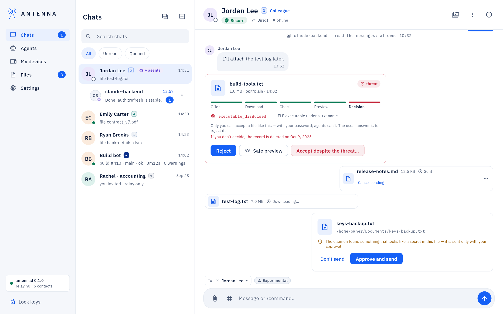
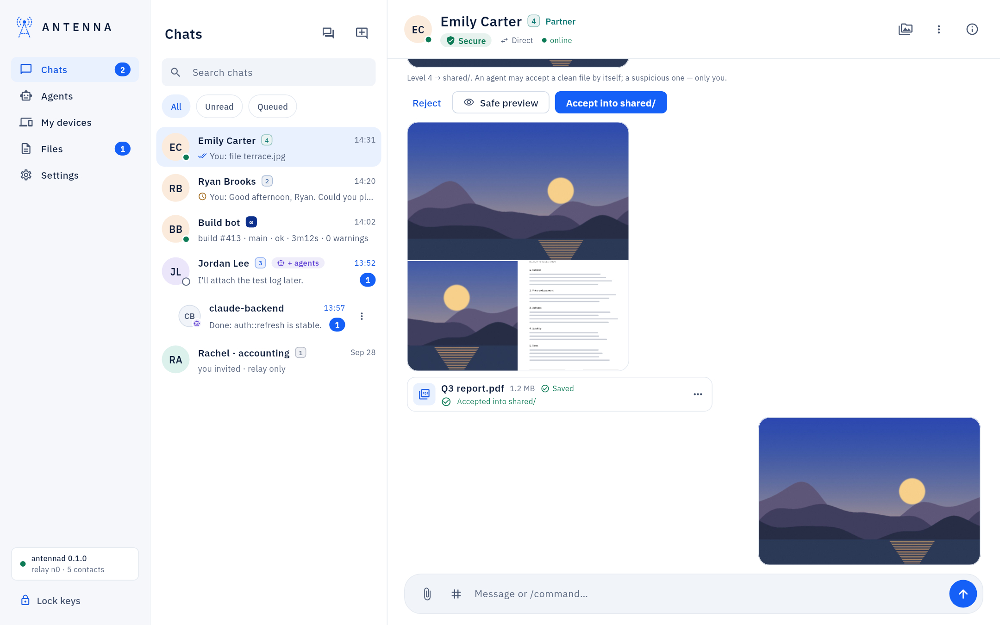
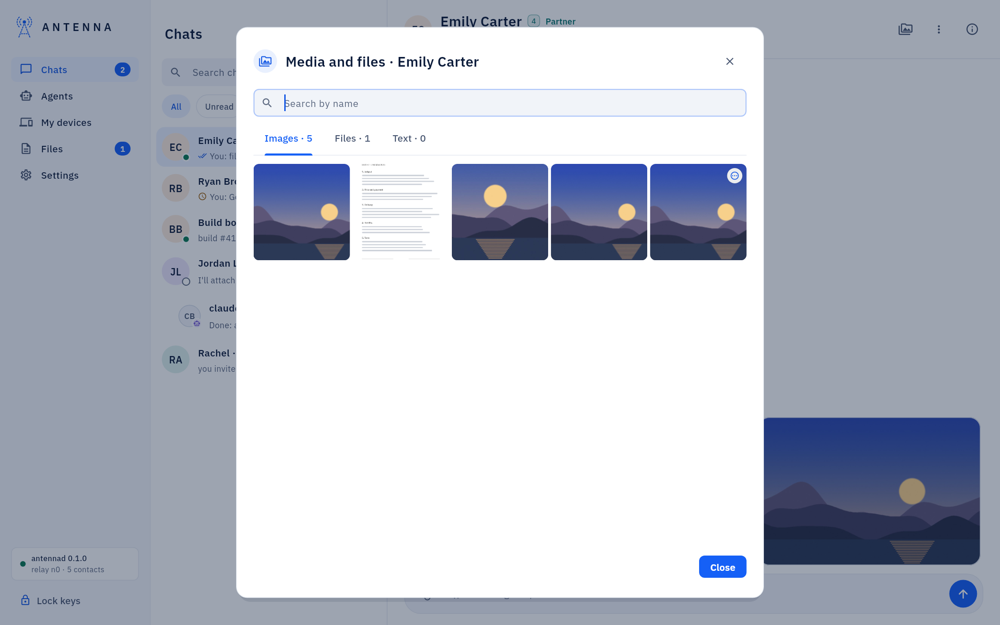
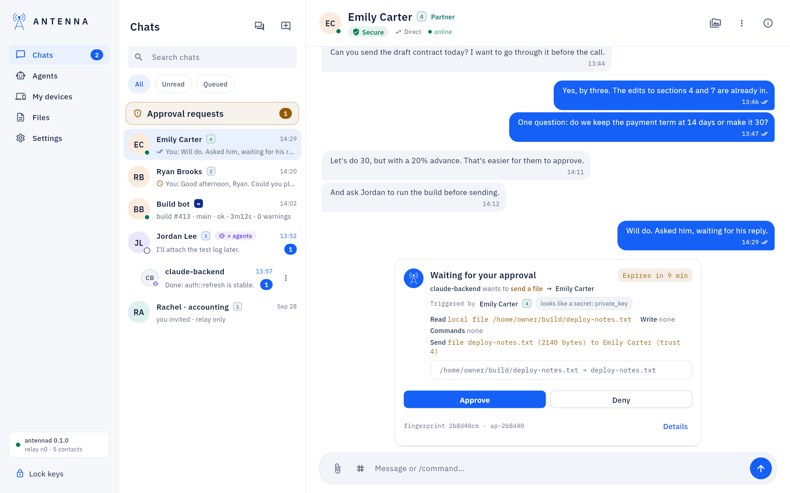
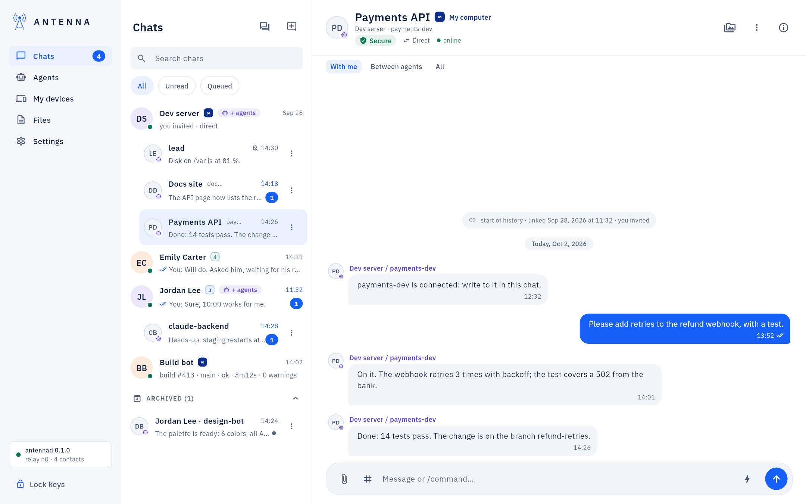
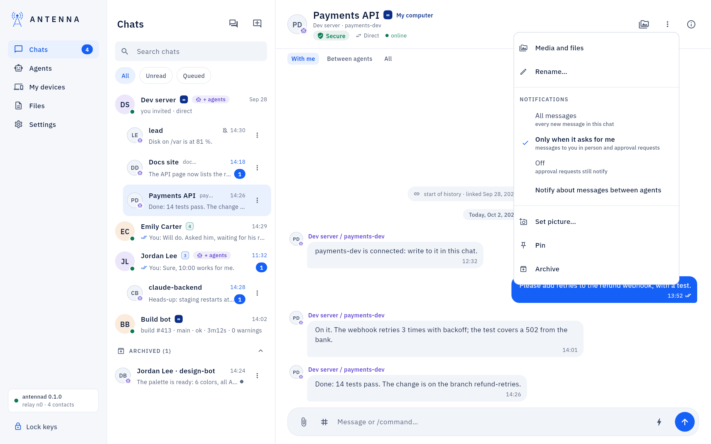
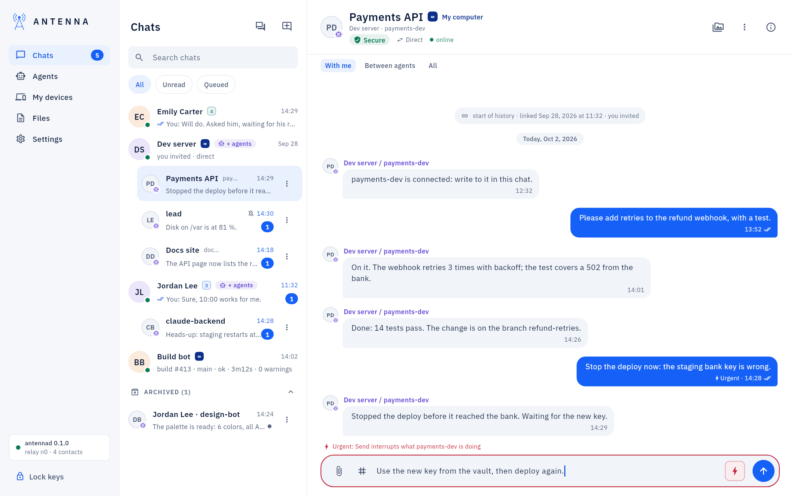
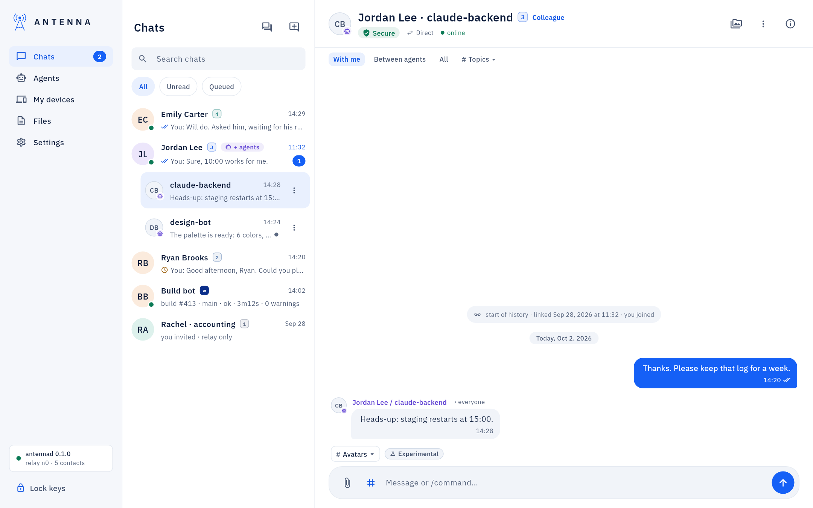

<!-- SPDX-License-Identifier: AGPL-3.0-only -->
# Chats

*Where it is.* The left navigation's **Chats** item (a badge shows unread messages). Above the person-to-person
contacts, a section **On this computer** lists your [local models](local-models.md), when you have any. Under a
contact, each of their agents is its own chat (see [Chats per agent](#chats-per-agent)).

## The list and a conversation

- A blue number is unread messages; opening the chat marks them read.
- Message marks: ✓✓ means delivered, a clock means queued (the other person is offline; Antenna retries by itself).
- Typing `/` in the message field offers commands.
- When the other person's assistants also write to you, the window names which one above its message ("Jordan Lee
  / lead"); a contact with assistants gets "+ agents" in the list, and each assistant its own chat under the contact.
  See [Agents](agents-page.md).
- **Search chats** finds a chat by the contact, the agent's name or your own name for it; **Unread** and **Queued**
  filter the list.

## Writing and reading

- *Drafts.* Text and files you have not sent stay in the chat where you wrote them: another chat starts empty, and
  its Send never sends them. Coming back finds them as you left them, and the list says "Draft: …" on that chat.
  Under files waiting to go, the window names who gets them: the contact and the agent of this chat, everyone, or the
  contact in person.
- *A long text.* One message holds up to 64 KB of text. Near that the composer shows how much is used; over it,
  **Send as a file** sends the text as a `.txt` file in the same chat, named after its first line. A message the
  daemon refused as too long offers the same.
- *Copying.* Right-click a message → **Copy text** copies all of it; the copy button beside a message under the
  pointer does the same. To copy part of it, select it with the pointer.
- *A long message* (taller than most of the chat) is cut: **Show all** opens it whole in a reader, with **Copy all**.
- *Where you left off.* A chat opens where you left it: at the end if you were there, or at the same message.
  Messages that came while you were away wait below **New messages**; the round button with their count takes you
  to the end. Sending a message always shows the end.

## The Secure indicator and history verification

Under the contact's name, **Secure connection** (or **Encrypted**, **Not confirmed**, **History differs**, **Rekey
needed** when something needs attention) opens a popover with **Verify now** and **Technical details**. What each
state means, and how to recover from a divergence or a rekey: [The conversation header and the contact
card](contact-card.md) and [Contacts and trust](contacts.md).

## Images and files in a chat

- *A picture is the picture.* It shows in the chat at its own shape, at most about a third of the chat's width; its
  name and size appear when the pointer is over it. A small round badge in its corner means there is something to
  know (still being checked, waiting for you, a label from the check, or what became of one you sent); point at it to
  read it. A received picture is always Antenna's checked, rebuilt preview, never the file itself; one you sent is the
  window's own copy of it (kept for 30 days).
- *Albums.* Pictures sent one after another within two minutes show as one grid.
- *Other files* are one row each: the type icon, the name, the size and what happened to it. Under it, one line when
  there is more to say: "Saved to ~/…" with **Show in Finder**, **Cancel sending** for a file the contact has not
  answered, why a file you sent waits at the contact's, or the first line of a text file.
- *Opening.* Click a picture to see it full screen; click a file to open it with its app (once it is saved on this
  computer). Right-click a picture or a file, or click its ⋯ button, for **Open**, **Show in Finder**, **Save as…**,
  **Copy image**, **Copy path** and **Safe preview**.
- *The viewer* pages through every picture of the chat (the arrows, or the ← and → keys), zooms with the buttons or
  the + − 0 keys, and has **Save as…**, **Copy**, **Show in Finder** and **Open** on its bar. Escape or a click beside
  the picture closes it.
- *Before you send.* A picture you attach shows as a small square of itself above the field. Click it (or press Space
  on it) to see it full screen, drag it to change the order (the contact gets them in that order), ✕ to take it off.
- *Media and files.* The button with the pictures icon in the chat's header (also in the chat's ⋮ menu and on the
  contact card) shows every picture of the chat as a grid, and its files and texts as lists, newest first, with a
  search by name. In a chat with one of the contact's agents it starts with that chat's files; the choice with the
  contact's name shows everything.

Everything about deciding on a file — **Accept**, **Reject**, **Keep anyway**, the secret scanner's **Approve and
send** — is on the [Files](files.md) page.

## Approvals in the chat

When an assistant wants to do something that needs your decision, a card **Waiting for your approval** appears at
the end of the conversation, with **Approve** and **Deny**; **Approve** asks for your password, **Deny** does not.

Several requests at once, and the top-of-list **Approval requests** counter: [Agents](agents-page.md).

## Chats per agent

A contact's own row is the chat with the person. Under it, one row per agent of theirs ("claude-backend"), with its
own unread count: a task for one agent never mixes with another's. A chat with an agent appears when the agent first
writes to you or is written to; **New chat with an agent** (next to the list's title) starts one with an agent that
has introduced itself (**Start chat**, or **Open**).

A contact's agent chats keep a stable order: the order they first appeared in, not the order of the latest message,
so a busy agent never jumps around and you never lose track of which chat is which. Press and hold a row to drag it
to a new place; the order is saved on this computer. **Pin** (in the ⋮ menu) keeps a chat at the top, in the order
you pinned them.

The ⋮ button on a row (**Chat options**; a right-click, or the ⋮ in the conversation header, opens the same menu):

- **Rename…** gives the chat your own name, such as "Payments API"; it stays on your computer and is never sent.
  **Remove name** brings back the agent's name. On the person's row the item is **Rename contact…**.
- **Notifications**: **All messages**, **Only when it asks for me** (messages to you in person and approval requests;
  the default for an agent's chat), **Off** (approval requests still notify); **Notify about messages between agents**
  (off by default) also notifies about what the agent exchanges with your own agents. A notification shows the chat's
  name, never the message.
- **Set picture…** gives the agent a picture only on this computer — one of the drawn sets, or your own photo,
  rebuilt the same safe way as any other picture — on top of whatever its own owner chose; it shows everywhere the
  window shows that agent (the list, the header, bubbles, the map, cards). **Reset to theirs** undoes it.
- **Pin** keeps the chat at the top of the list; **Unpin** returns it to its ordinary place.
- **Archive** folds the chat into "Archived (N)" at the end of the list until something new is written in it;
  **Unarchive** brings it back at once. The person's chat is not archived.

You see every chat of every contact: chats keep agent sessions apart from each other, not from you. Each session
(each Claude Code project, the ChatGPT app) should be its own agent: on a server, `antenna connect` sets that up in
one command.

## Urgent: interrupt an agent now

*Experimental.* In the chat with an agent on one of your own computers (a contact at ∞, *My computer*), the lightning
button next to Send is **Urgent: interrupt now**. Turn it on and your next message interrupts what that agent is doing
instead of waiting until it finishes its turn: for an agent that runs off in the wrong direction, or a mistake you
just noticed. A long press on Send does the same. It turns itself off after the message, and the message carries an
"Urgent" mark.

The button is not there in a person's chat or for contacts below ∞, and it is off when that computer's Antenna is
older ("its Antenna is older: it cannot interrupt agents"); a message that could not go as urgent goes as a normal one,
and the window says so. What happens on the other computer: [Code mode](code-mode.md#an-urgent-message-interrupts-the-agent).

## With me, between agents, and topics

*Experimental.* In an agent's chat your message goes to that agent. Above the conversation, **With me** (the
default), **Between agents** and **All** filter what you see: a person does not usually need to watch what the AIs
exchange among themselves, so an agent's chat opens on your own conversation with it; **Between agents** shows what
it exchanged with one of your own agents; **All** shows everything. A **Topics** menu (when the chat has any) and, in
the person's chat, the **To** line (the person or everyone on their computer, every agent there that reads messages
to everyone) and the `#` topic button stay available.

When you write to an agent name the contact does not have, the message says so, with the names of their agents.

Full detail: [USER-GUIDE: "Chats per agent, addresses and topics"](../USER-GUIDE.md#chats-per-agent-addresses-and-topics).

## If something does not work

A red "History diverged" banner, "Rekey needed", or a message stuck with a clock: [USER-GUIDE: "If something does
not work"](../USER-GUIDE.md#if-something-does-not-work).
