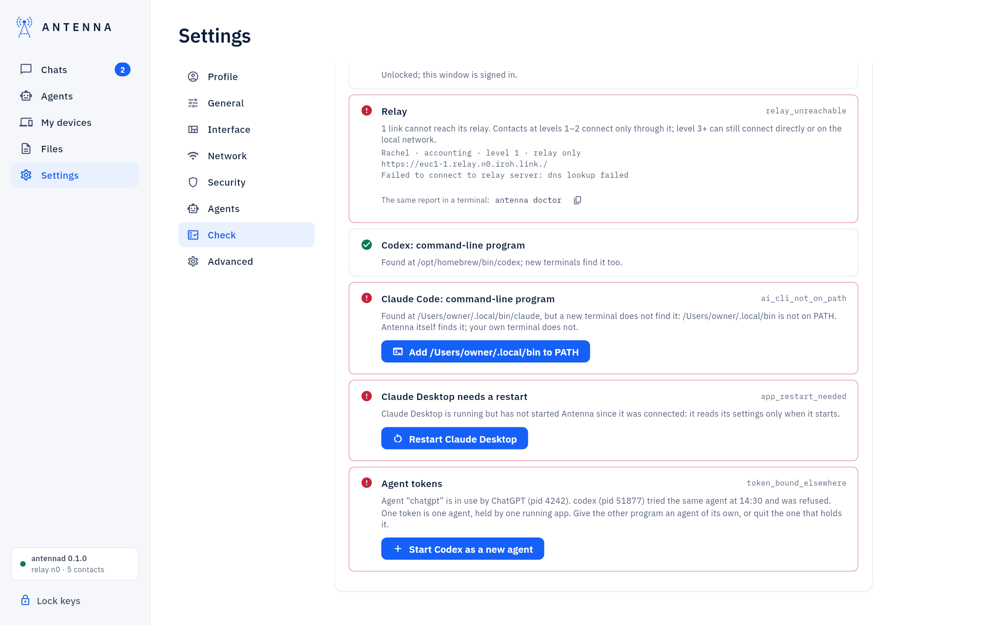
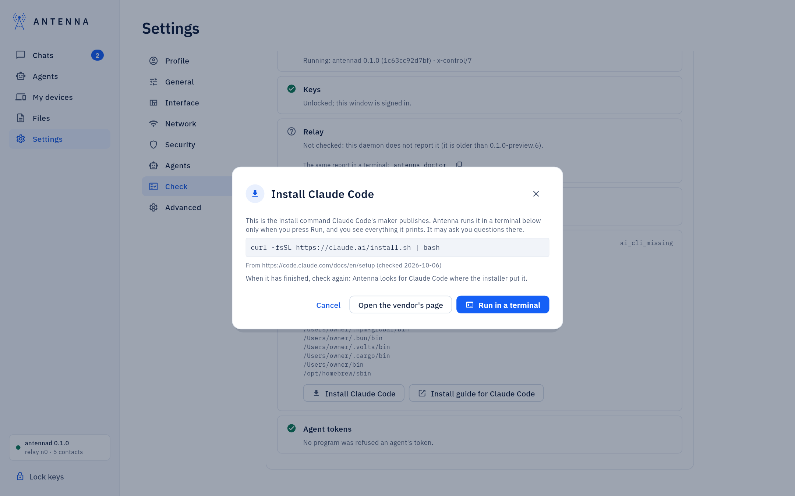

<!-- SPDX-License-Identifier: AGPL-3.0-only -->
# Check

*Where it is.* **Settings → Check** (or **Check Antenna** on the sign-in screen). Looks at this computer and
Antenna's service and lists what it found, each problem with a button that fixes it — nothing runs before you click.

## What it checks

| Check | The button |
| --- | --- |
| Antenna's service does not run | **Start Antenna** |
| The keys are locked, or this window is signed out | **Unlock** / **Sign in** |
| A contact's link cannot reach its relay | The same report as `antenna doctor`; **Turn on the local network** when a contact at level 3+ is on the same network |
| An AI app's command is not installed | "Install *app*": the maker's own command, run in a terminal here after **Run in a terminal**; "Install guide for *app*" opens the maker's page |
| It is installed, but your terminal does not find it | "Add *folder* to PATH" |
| An app has not loaded Antenna since you connected it | "Restart *app*" |
| A program was refused an agent another program holds | "Start *app* as a new agent" |
| On a Mac: this build has no Screen Recording (screenshots for agents) | The steps and **Open Screen Recording settings** |

*Installing an AI app's command.* The dialog shows the exact command and the page it comes from; nothing runs until
you press **Run in a terminal**. Then it runs in a terminal in the same dialog: you see all it prints, can answer its
questions, **Stop** it, and **Check again** when it has finished.

Full table, with every message's exact wording: [USER-GUIDE: "Check"](../USER-GUIDE.md#check).

## If something does not work

**Settings → Check** is itself the first thing to try when you do not know what is wrong: [USER-GUIDE: "If something
does not work"](../USER-GUIDE.md#if-something-does-not-work).
