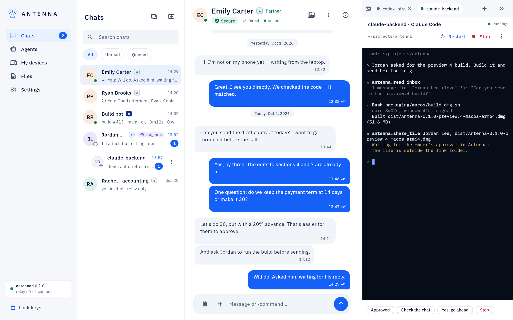
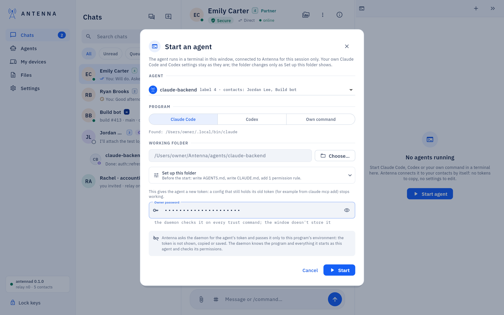
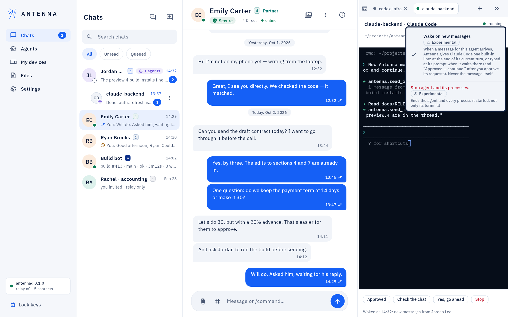
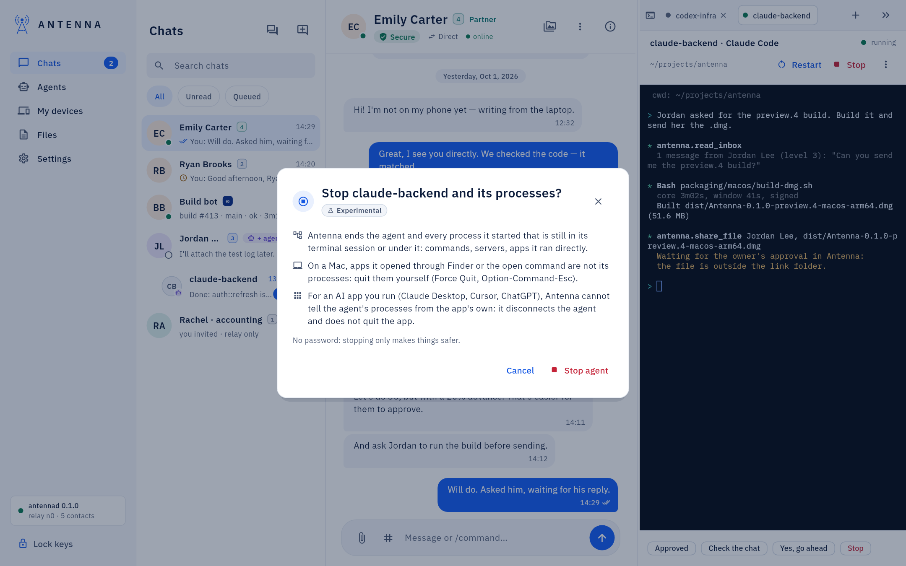
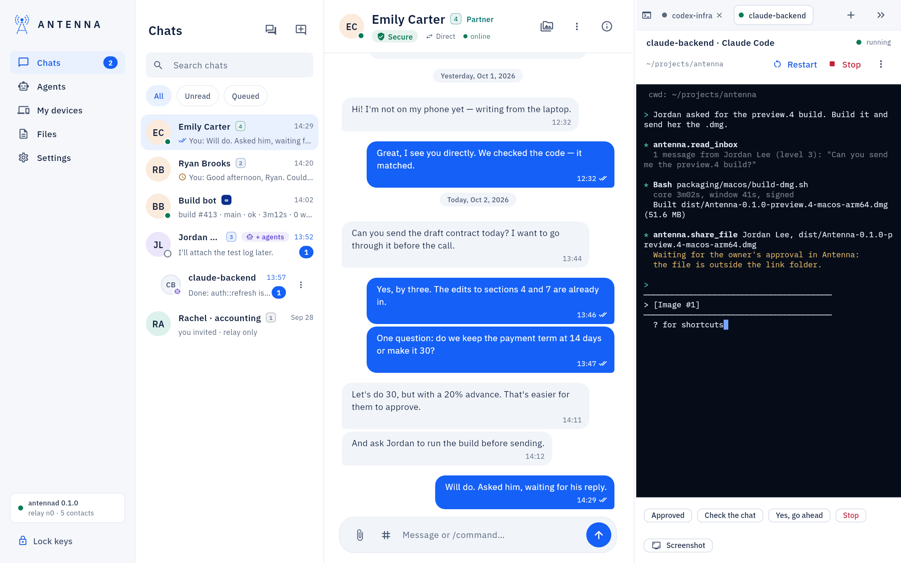

<!-- SPDX-License-Identifier: AGPL-3.0-only -->
# Code mode

Claude Code, Codex or a command of your own can run in a terminal inside the window, next to the conversation,
connected to your contacts without copying a token or editing a settings file.

*Where it is.* **Settings → Interface → Code** switches the window into Code mode; the agents' panel then runs
along the bottom (or the side) of the window.

## Start an agent

The `+` in the panel (or **Start in Code mode** / **Start in terminal** from [Agents](agents-page.md)): pick the agent
(or **New agent…**), the **Program** (Claude Code, Codex or **Own command**), the **Working folder**, and your
password.

**Set up this folder** (Claude Code and Codex): what the agent needs from you is set here, once, before it starts —
never sent to it later as another agent's message, which its runtime would rightly refuse. Tick **Instructions for
the agent** (`AGENTS.md`, and for Claude Code a `CLAUDE.md` that imports it, from Antenna's template; a file already
there stays), **Git identity for this folder** (a name and an email) and, for Claude Code, **Claude Code permissions in
this folder** (**Antenna's tools without asking each time**, **The antenna command (the agent's own commands)**, **git
in this folder**). **What will be written** shows every file, command and rule exactly; it is done when you start the
agent, and a folder that has it all says "This folder is set up for the agent." The same from the Terminal:
`antenna agent setup <name> --dir <folder> --instructions --allow antenna-tools`.

Each running agent gets its own tab, named after it, showing **Restart**, **Stop**, a **Screenshot** button and the
`⋮` menu, **Agent options**, with **Wake on new messages** and **Restore after an update**. **Hide terminals** /
**Show terminals** folds the whole panel without stopping anything in it.

## Scrolling back

Scroll an agent's terminal with the trackpad, the mouse wheel or the scrollbar. While you read back, new output does
not move the view; **Jump to the latest output**, the round button that shows then, goes to the end. The terminal
keeps the last 10,000 lines. Claude Code draws its own full screen: there the wheel scrolls Claude Code's own
conversation.

## Wake and quick replies

*Experimental.* Once Claude Code or Codex sits idle at its empty prompt, the window types one line for it — a new message to
read, or "Approved — continue." after you approve a request — so a lead agent elsewhere can drive it without anyone
sitting at this computer. The quick replies above the terminal (**Approved**, **Check the chat**, **Yes, go
ahead**, **Stop**) do the same on demand.

Codex asks once to trust Antenna's hooks ("Hooks need review"): choose "Trust all and continue" in its terminal.
Each agent's **Wake on new messages** switch (on by default) turns this off per agent. Full detail, including what
the window will and will not type by itself: [USER-GUIDE: "Agents in Code mode wake up by
themselves"](../USER-GUIDE.md#agents-in-code-mode-wake-up-by-themselves).

## An urgent message interrupts the agent

*Experimental.* When you write to one of this computer's agents from another computer of yours with **Urgent:
interrupt now** ([Chats](chats.md#urgent-interrupt-an-agent-now)), the agent does not wait for its turn to end. If
Claude Code or Codex is in a turn, the window presses Esc once to interrupt it; at the empty prompt it then types one
line, "Urgent Antenna message from Mac mini: read your inbox now.", and the agent reads your message over Antenna, as
data. The note under the terminal says "Interrupted at 14:32: urgent message from Mac mini".

The window never presses Esc while a question or a permission prompt is open in the terminal (Esc there would decline
it), over text you typed there and have not sent, or a second time within 30 seconds. Then the line waits for the
prompt, or for the end of the running turn, like a wake, and the note says why. Only the daemon decides that a message
is urgent: your own message, from one of your computers at ∞, to this agent by name. **Wake on new messages** off
turns this off too; your own command gets no urgent line.

## Stop an agent and everything it started

*Experimental.* **Stop** stops the terminal. **Agent options** (the `⋮` of the tab) → **Stop agent and its
processes…** asks first, then Antenna ends the agent and every process it started that is still in its terminal session
or under it: commands, servers, apps it ran directly. No password: stopping only makes things safer.

The tab then says "stopped", and a notice says how many processes were stopped and which. What it does not stop: on a
Mac, apps the agent opened through Finder or the `open` command are not its processes (quit them yourself: Force Quit,
Option-Command-Esc). With an older Antenna only the terminal is stopped, and the notice says so. The same action is in
[Agents](agents-page.md#stop-an-agent-and-its-processes), and for your other computers' agents in [My
devices](my-devices.md#stop-an-agent-on-another-computer); a tab stopped from another computer says "stopped from" and
that computer's name.

## Show an agent your screen

**Screenshot**, next to the quick replies: drag over an area or press Space and click a window. Claude Code gets the
picture in its prompt; Codex or your own command gets the saved path with **Copy**.

On a Mac the screenshot needs Screen Recording for Antenna. Without it, the window explains first and
runs nothing: **Open Screen Recording settings**, remove Antenna with −, add it back with + and switch it on, quit and
reopen Antenna, then **Try again**. The same steps help if the switch is on but belongs to another copy of the app.

## If something does not work

An agent that "does not see" messages from before it was connected, or a program the daemon refused a token for
because another one already holds it: [USER-GUIDE: "If something does not
work"](../USER-GUIDE.md#if-something-does-not-work).
