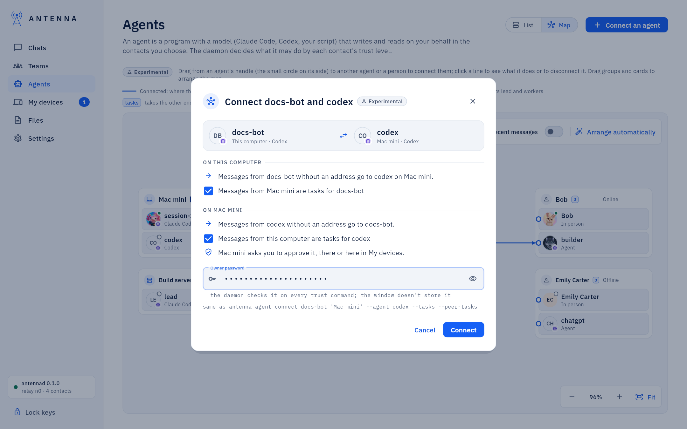
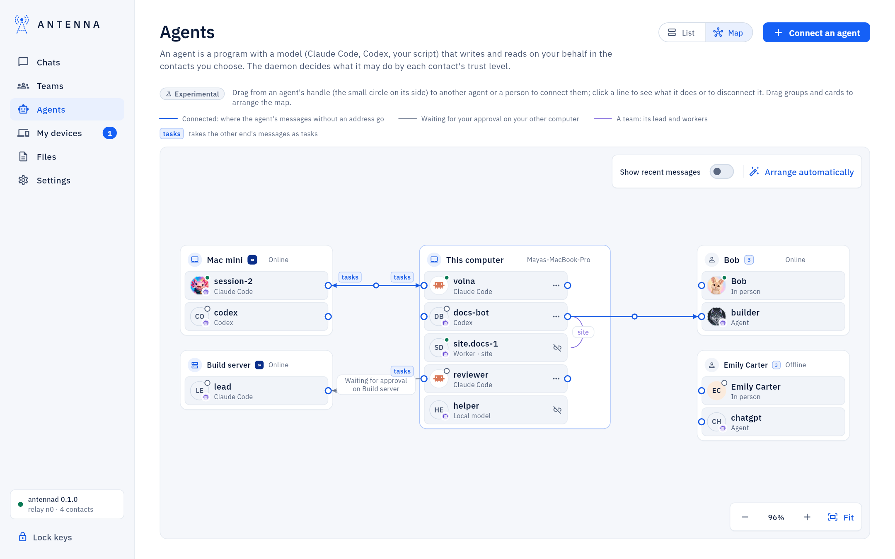

<!-- SPDX-License-Identifier: AGPL-3.0-only -->
# Connect two agents

Connecting an agent to another agent (or to a person) sets where its messages go when it does not name a contact: its
*default counterpart*. A typical case: a Claude Code session on your Mac and an agent on your server, so that when you
tell one of them "ask the other", it knows who that is. You can also let each one take the other's messages as
*tasks*, work you authorized, instead of plain information. Antenna's service on each computer sets its own side and
still checks every action. *Experimental.*

This page is the short how-to. The map itself, every kind of line and every message of the dialog:
[Agent map](agent-map.md).

*Before you start.* Both agents exist ([Add an agent on this computer](add-an-agent.md), [Add a server and its
agents](add-a-server.md)). The other end is on another computer: one of your own, which you and it have at ∞, or a
contact's. A contact's agents show once they have written to you or the contact announced them.

## Connect

1. Open **Agents → Map**.
2. Drag from one of this computer's agents to the other agent, or to a person, and let go. Without dragging: the
   agent's menu → **Connect to…**, then pick the other end.
3. A dialog says what changes on each side, in plain words:
   - **On this computer**: messages from your agent without an address go to the other end. A checkbox decides
     whether your agent takes the other end's messages as tasks: ticked by default for your own computers, unticked
     for anyone else, since tasks are for people you trust.
   - *On your other computer*, when the other end is an agent of one of your computers: its messages without an
     address come back to your agent, with its own tasks checkbox. That computer changes nothing by itself: it asks you
     to approve it, there or here in **My devices**.
   - *A contact's agent*: only this computer changes. The contact's side is the contact's decision.
   - *A person*: your agent's messages without an address go to that person, who reads them in person.
4. Enter your password and press **Connect**.



## Approve the other side

When the other end is on another computer of yours, the dialog then says the request waits for your approval there.
Approve it in any of these places:

- **Approve now**, right in the dialog: **Approve with Touch ID** or **Approve with password**, or **Deny**;
- **My devices**, on that computer's card, among its requests waiting for you;
- on that computer itself, among its approval requests. On a server without a window: `antenna approvals` lists them,
  `antenna approve <id>` approves one.

That computer carries the change out once you approve. The request says in words what it sets, for example: "Connect
builder with writer on mac: messages from builder without an address go to writer."

Answering from this computer needs the other computer to accept this one's approvals, once: on that computer,
**My devices** → this computer's card → **Approvals**, or `antenna devices confirm <this computer>` in its terminal.
Details: [My devices](my-devices.md#accepting-approvals-from-another-computer).

## What a connection does

Once connected, the messages your agent sends without naming a contact go to the other end; with the tasks box ticked,
the other end's messages are tasks for it. A line marked *Messages lately* only says two agents wrote to each other
recently: it is not a connection and sets nothing. How the map draws each kind of line: [Agent map](agent-map.md).



## Disconnect

Click the line, then **Disconnect…**; or the agent's menu → **Disconnect…**. The dialog says what goes away (the
agent's messages without an address need a contact again) and offers to also stop taking tasks from the other end
and, for your own computer, to ask it to remove its side too. **Disconnect** needs no password: it only takes
something away.

## From a terminal

```
antenna agent connect <agent> <contact> --agent <their agent>
antenna agent disconnect <agent>
antenna agent traffic
antenna agent list
```

- `connect`: `<agent>` is this computer's agent, `<contact>` the other computer or contact as you named it, and
  `--agent` the agent there (without it, the line goes to the person). `--tasks` or `--no-tasks` sets whether your agent
  takes that contact's messages as tasks; for your own computer, `--peer-tasks` or `--no-peer-tasks` the same for the
  agent there, and `--here-only` changes only this computer and asks nothing there. It asks for your password.
- `disconnect`: without a contact it removes the agent's current counterpart; `antenna agent disconnect <agent>
  <contact> --agent <their agent>` removes that particular line. `--no-tasks` also stops tasks from it. No password.
- `traffic`: who talked to whom in the last 30 days (`--days N` for another span), one line per agent and
  counterpart.
- `list`: your agents, each with its counterpart.

An example: on the Mac, connect its agent `writer` to the agent `builder` on the server it calls `build-server`, with
tasks both ways:

```
antenna agent connect writer build-server --agent builder --tasks --peer-tasks
```

An agent sees its own counterpart in its session, and cannot change it: only you can.

## If something does not work

After **Connect**, the dialog says what happened on the other side: it already had this connection; its Antenna does
not know connections yet (update it there); it could not be reached (this side is set, and **Ask again** sends the same
request); or it refused, with its reason. When this computer's own Antenna is too old, the map says that connecting
agents needs a newer Antenna. More: [Agent map](agent-map.md).
