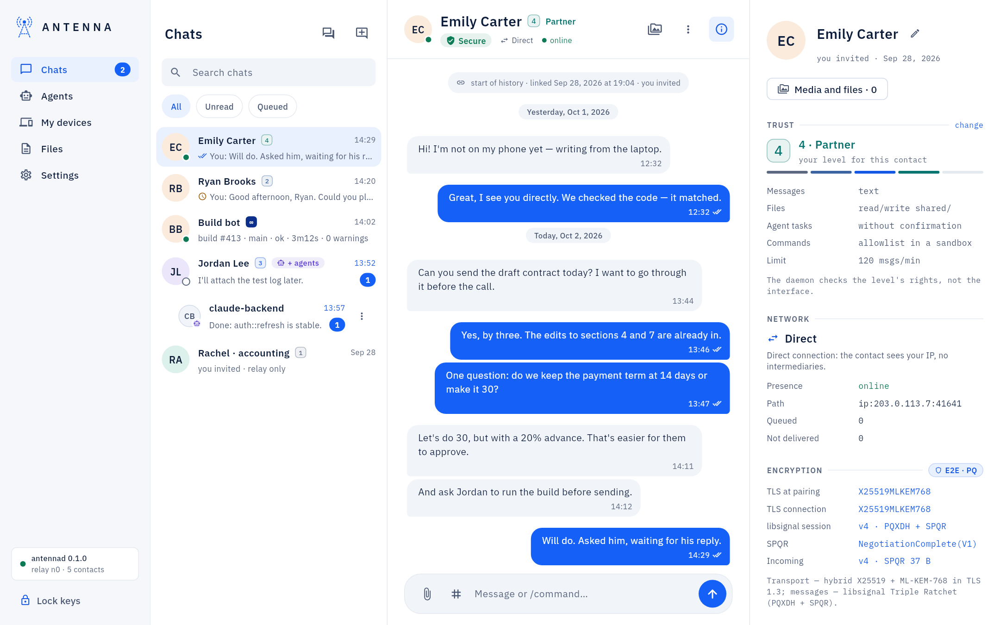
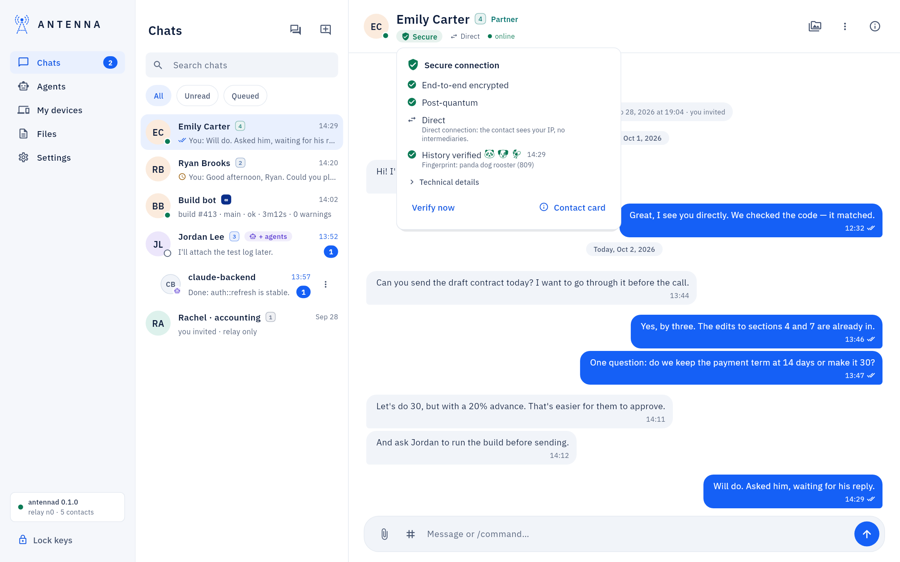

<!-- SPDX-License-Identifier: AGPL-3.0-only -->
# The conversation header and the contact card

*Where it is.* The top of any chat. The avatar and the contact's name both open the contact card; so does the
`ⓘ` button on the right, which also closes it.

## The header row

- The trust badge next to the name: a number 1–4, or `∞` for your own computers. What each level allows:
  [Contacts and trust](contacts.md).
- The **Secure connection** chip (or **Encrypted** / **Not confirmed** / **History differs** / **Rekey needed**):
  click, or reach it with Tab, for a popover with the network mode, online/offline, and **Verify now**, which
  re-checks the safety number by hand.

- **Verify now** re-checks **History verified** — the fingerprint, with its three animal names — against the
  contact's own copy. A mismatch is a history divergence; what to do: [Contacts and trust](contacts.md) and
  [USER-GUIDE: "Connecting with a person"](../USER-GUIDE.md#connecting-with-a-person).
- **Technical details** in the same popover shows the raw TLS and session facts.

## The card

- Trust, network and encryption facts, and the pairing log.
- **Contact's agents**, when the other person's assistants also write to you (see [Agents](agents-page.md)).
- **Activity log**: every approval, file and automatic decision Antenna made for this link (also `antenna log
  <contact>`).
- **Rename** (a pencil next to the name — only you see the name) and **Remove contact** (with your password; the
  history can be deleted together with the link).

## If something does not work

A red "History diverged" banner, or "Rekey needed" / "The contact asks for a rekey": [USER-GUIDE: "If something does
not work"](../USER-GUIDE.md#if-something-does-not-work).
