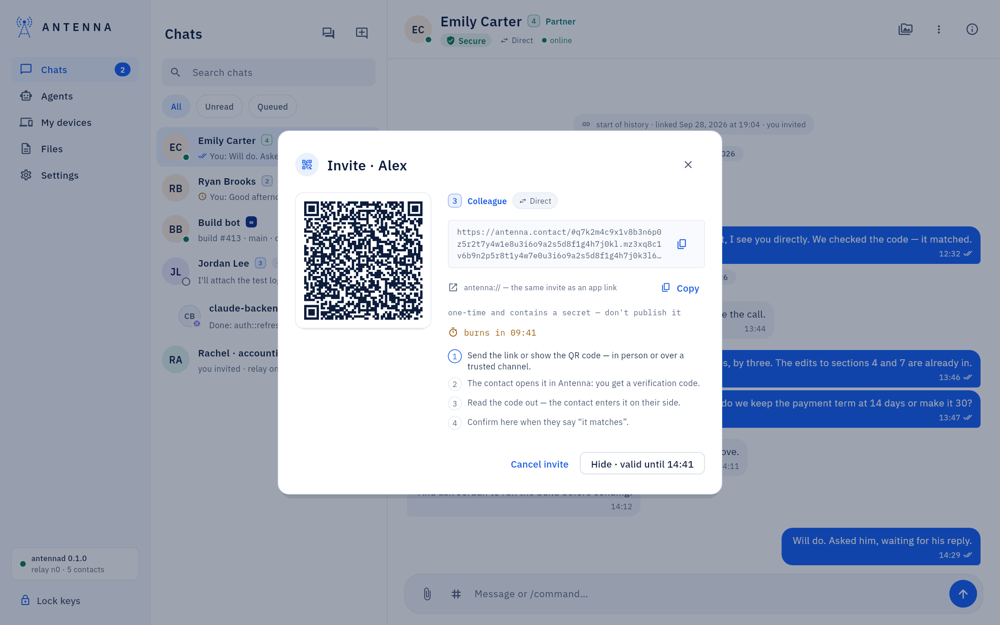
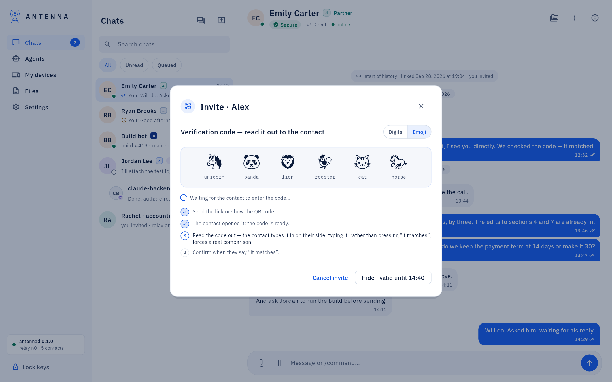
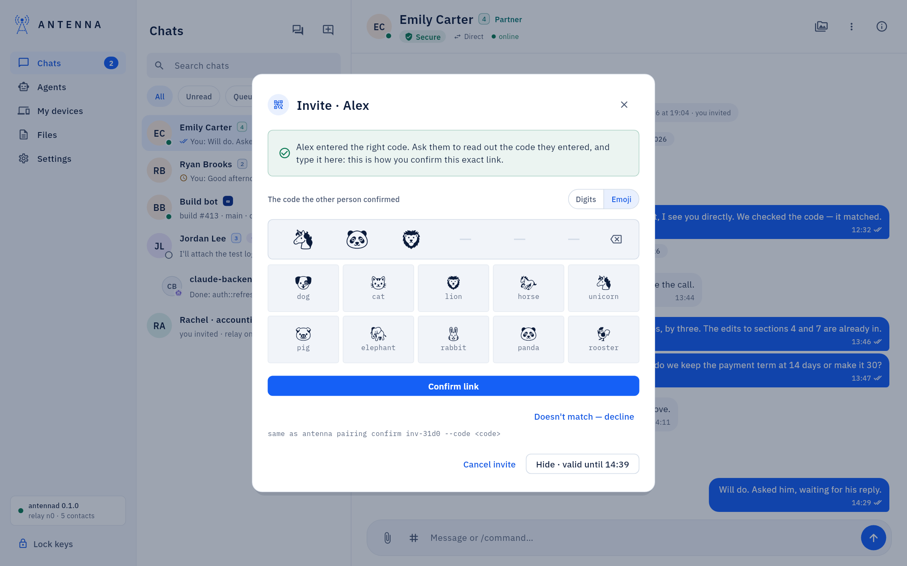
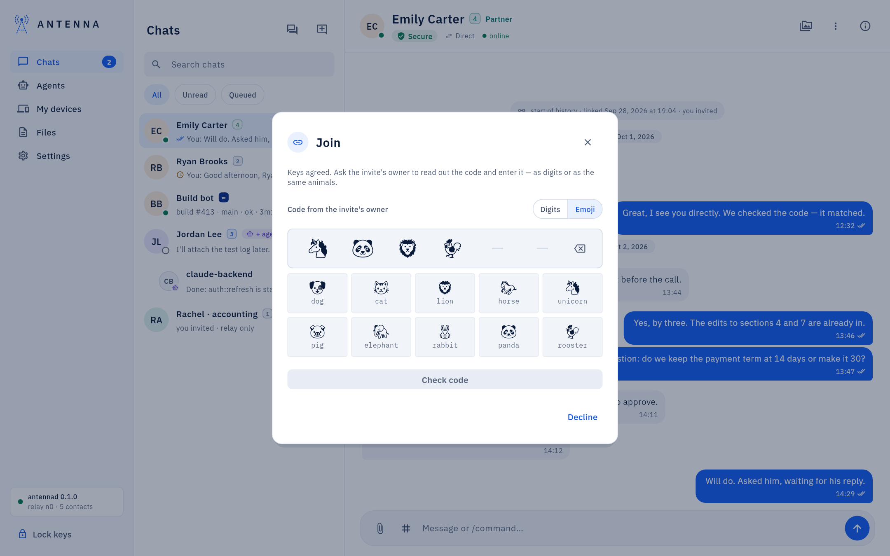
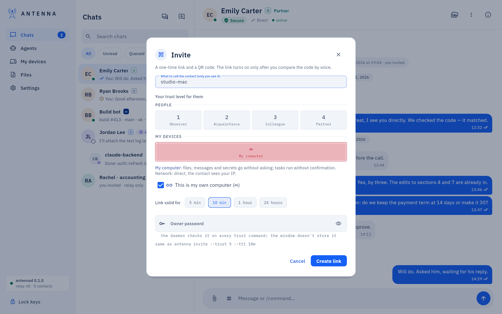
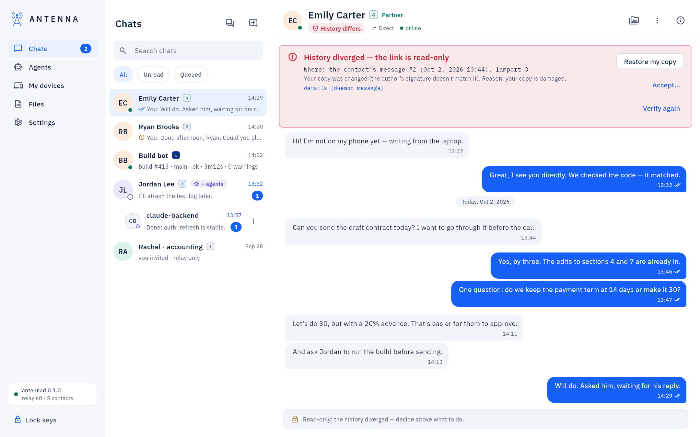
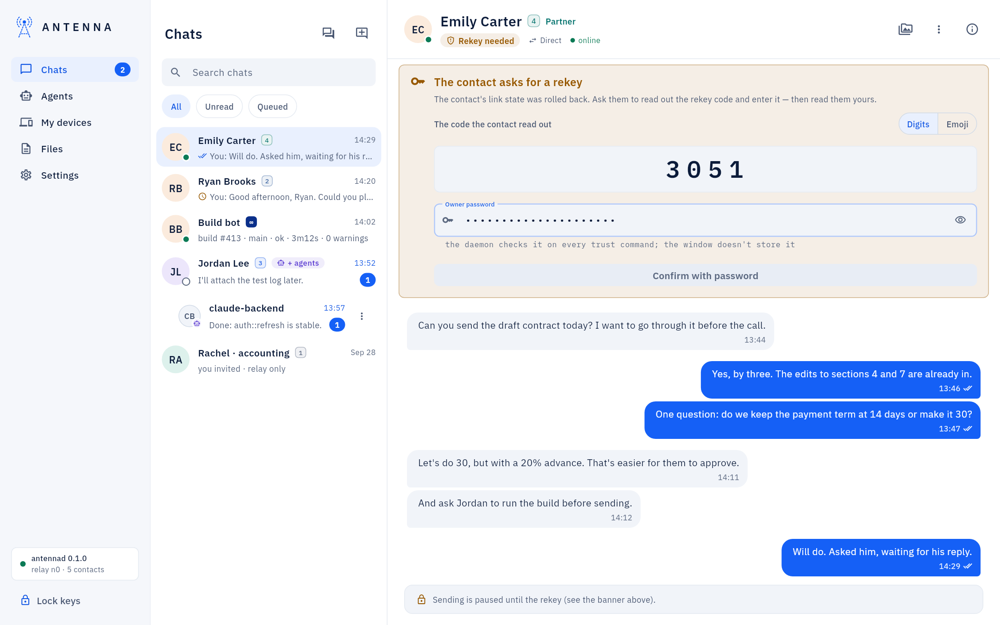

<!-- SPDX-License-Identifier: AGPL-3.0-only -->
# Contacts and trust

*Where it is.* **New contact → Invite** (you invite) or **New contact → Join** (you were invited), from the chat
list; trust level and rename live in the contact card ([The conversation header and the contact card](contact-card.md)).

## Pairing

1. **Invite**: name the contact, choose a trust level and the link's lifetime, pass on the link or the QR code.

   

2. A 6-digit or 6-animal code appears on the other side — read it out loud.

   

3. Once the other person says the code matched, press **The contact confirmed — codes match** (no second password
   needed); if it did not match, **Doesn't match — decline**.

   

4. **Join**: paste the link, name the contact, choose a level, enter the code you were read and read it back.

   

Full walkthrough: [USER-GUIDE: "Connecting with a person"](../USER-GUIDE.md#connecting-with-a-person).

## Trust levels

Each contact, human or assistant, gets a level the program enforces — not a suggestion to the model. **Observer**
(strangers: text only), **Acquaintance** (new contacts, the default: files go to quarantine), **Colleague** (the
shared folder is read-only), **Partner** (the shared folder is read and write, builds run in a sandbox), and `∞`
(**My computer**, only your own machines: files and secrets go without asking). Full table and what changes at each
level: [USER-GUIDE: "Trust levels"](../USER-GUIDE.md#trust-levels).

*Your own machines.* Tick **This is my own computer (∞)** when pairing one of your own, or set it in an existing
contact's card — a warning is shown once, since it hands that machine your secrets without asking. Full detail:
[USER-GUIDE: "Your own machines"](../USER-GUIDE.md#your-own-machines).

## History verification, divergence and rekey

**Verify now**, in the contact card's Secure popover, checks **History verified** by hand. A red banner means the
two copies diverged — **Restore my copy**, or **Accept…** with the password to lift the read-only state while the
divergence stays on record.

After restoring an Antenna database from a backup, the old keys cannot be used: a rekey trades two codes, one
read out each way.

Full recovery steps: [USER-GUIDE: "Connecting with a person"](../USER-GUIDE.md#connecting-with-a-person).

## Revoke

Remove a link entirely from the contact card's **Remove contact** (password; the history can be deleted with it).
Revoking an assistant's own access, rather than a whole contact, is on the [Agents](agents-page.md) page.

## If something does not work

"The code didn't match", "That's not this invite's code", "Invite unavailable", or a red "History diverged" banner:
[USER-GUIDE: "If something does not work"](../USER-GUIDE.md#if-something-does-not-work).
