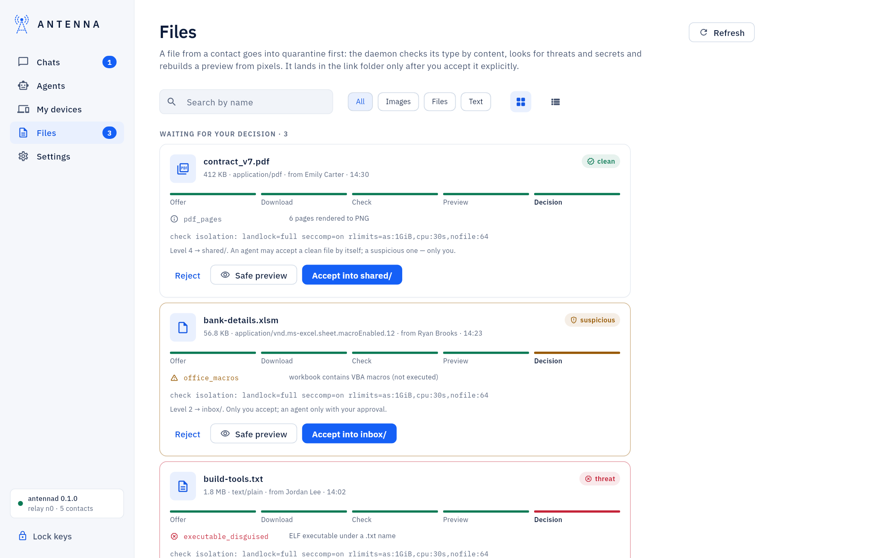
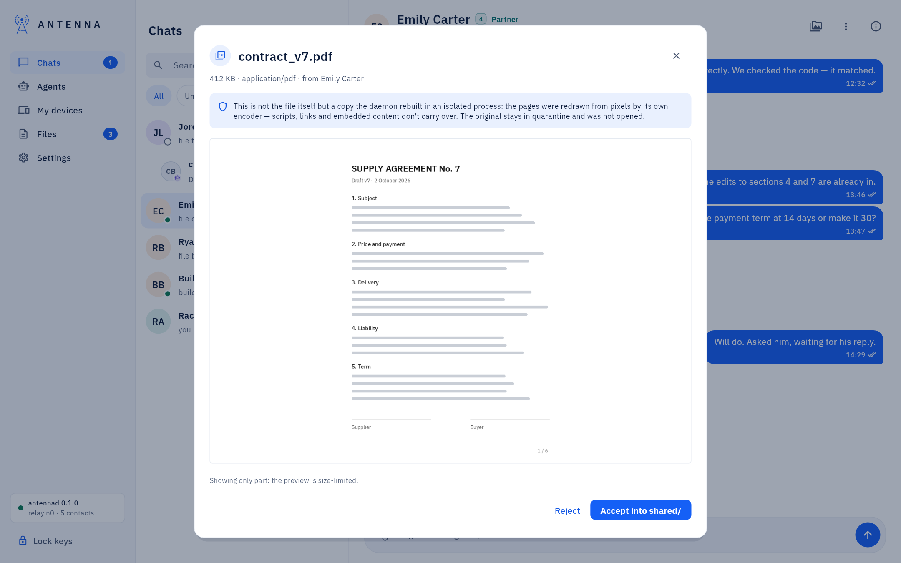
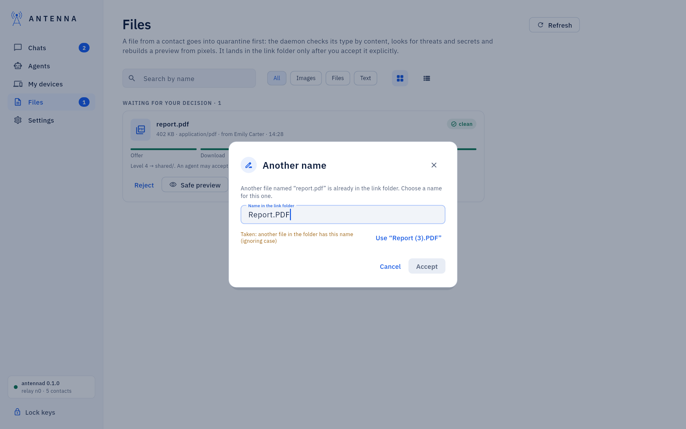

<!-- SPDX-License-Identifier: AGPL-3.0-only -->
# Files

A file from a contact sits in quarantine until Antenna has checked its type by content, looked for threats and
secrets, and rebuilt a safe preview — it lands in the link folder only once you accept it.

*Where it is.* The left navigation's **Files** item (a badge counts files waiting on your decision).

## The list

At the top, what needs you: **Waiting for your decision**, each file as a card with its buttons. Then **Downloading
and checking**, then **All files**, newest first: pictures as a grid of small squares (the list button next to the
filters shows everything as rows), every other file as one row. **Images**, **Files** and **Text** show only that
kind, and **Search by name** finds a file in every group. Each file has the same actions as in a chat: click a picture
to see it full screen, click a file to open it, right-click or the ⋯ button for **Open**, **Show in Finder**,
**Save as…**, **Copy image**, **Copy path** and **Safe preview**. A banner above the list, "Antenna *version* is ready
to install", appears whenever a newer signed release can be installed — see [Updates](updates.md).

## Deciding on a file

A file card's usual buttons: **Reject**, **Safe preview** (the daemon's rebuilt pixels, before you decide),
**Accept** (or "Accept into" a named folder, when a project folder is set), **Cancel sending** (an offer still
waiting), **Retry**, **Dismiss**.

A file the secret scanner held at Send offers **Approve and send** / **Don't send**: what it found is shown as a
quote, never acted on by itself.

## What Antenna holds, and labels

From a contact at level 3, 4 or your own computer (∞), Antenna never holds an ordinary file: a picture, a web page
with scripts, an archive of code, a text that looks like it has a password in it. What the check noticed shows as
quiet labels on the card ("active_content", "secret:password"), and code and markup carry "Code: Antenna does not run
it". From your own computer such a file is saved by itself; from a contact at 3–4 it waits for your Accept, or one of
your agents accepts it.

What can run or install software waits for you, the way a browser warns about a dangerous download: a program (Mach-O,
ELF, Windows EXE), an installer or disk image, an archive that holds one, a file your antivirus flags, and from a
contact at 3–4 also an archive Antenna could not look inside. The card says what the danger is, with **Delete** and
**Keep anyway** (your password). Agents can't keep such a file. Signed Antenna updates from your own computer are not
held. At levels 1–2 nothing changed: you decide every file.

Your own computers can be allowed more. On such a computer's card (the ⓘ button in its chat), **Files from this
computer** has:
- where its files are saved, and where each of its agents' files are: **Choose folder…** picks a folder in your home
  (your password or Touch ID), **Default** goes back to the link folder;
- **Saved without asking**: **Programs**, **Installers and disk images** or **An extension…** (such as `.dmg`) are then
  saved at once while the computer stays at ∞ (your password or Touch ID); the ✕ on one makes Antenna ask again.
The same in the Terminal: `antenna files allow <contact> executables` (or `installers`, or `.dmg`), `antenna files
disallow <contact>`, and `antenna files save-to <contact> ~/Desktop/Antenna` (`--agent voice-lead` for one of its
agents).

## What the sender sees

The card of a file you sent says what became of it: "Sent, waiting for the check", saved (and under what name),
"Waiting for *contact* to decide" when it is held there, "Declined" only when the contact's owner or agent said no, and
"Held by *contact*'s check" when their Antenna refused it. Your agents get the same in their inbox.

## Pictures

A picture shows as itself: in a chat at its own shape, here as a square of the grid. A received picture is always the
checked safe preview, one you sent the window's own copy. Clicking it opens the full-screen viewer with
**Previous image** / **Next image**, zoom, **Save as…**, **Copy** and **Show in Finder**. More in [Chats](chats.md).

## Renaming on accept

When another file in the folder already has the name, Antenna saves the new one as `report (2).pdf` (then `(3)`, and
so on), the way a browser saves a download: nothing is overwritten, nothing is dropped, and you are asked nothing. The
card says "Saved as report (2).pdf". If it is the same file that is already there, nothing new is saved and the card
says "Already in the folder: the same file". A file from your own computer (∞) is saved the same way by itself; if it
still cannot be saved, its card says why ("Not saved by itself: …") and it waits for you. Whoever sent the file is told
the name it was saved under.

**Another name** opens only when a name can't be used at all (a character a folder does not allow, for example), or
when the computer that receives the file runs an Antenna that refuses a taken name. It offers a
free name and checks each name you type.

## Where received files are, and your agents

An accepted file is in the contact's link folder, `~/Antenna/links/<folder>/` (`inbox/` at level 2, `shared/` at
levels 3–4 and ∞ when no project folder is set). A new link's folder is the contact's name as one word a
terminal takes without quotes — a contact named "hel server" gets `hel-server` — while the name you see stays as you
typed it; a folder made earlier keeps its name.

Your agents learn of a saved file by themselves: each agent that may see the file (not one addressed to another of your
agents) gets its name, where it is, its size and SHA-256 in its next inbox, and an agent that sent a file is told
when the contact accepted and saved it. In the Terminal an agent lists them with `antenna files list`. Hashes are shown
as SHA-256 (`shasum -a 256 <file>` on a Mac, `sha256sum <file>` on Linux) next to BLAKE3.

## If something does not work

"Not accepted: *reason*", a file stuck "Checking…", or a file an assistant could not accept by itself: [USER-GUIDE:
"If something does not work"](../USER-GUIDE.md#if-something-does-not-work).
