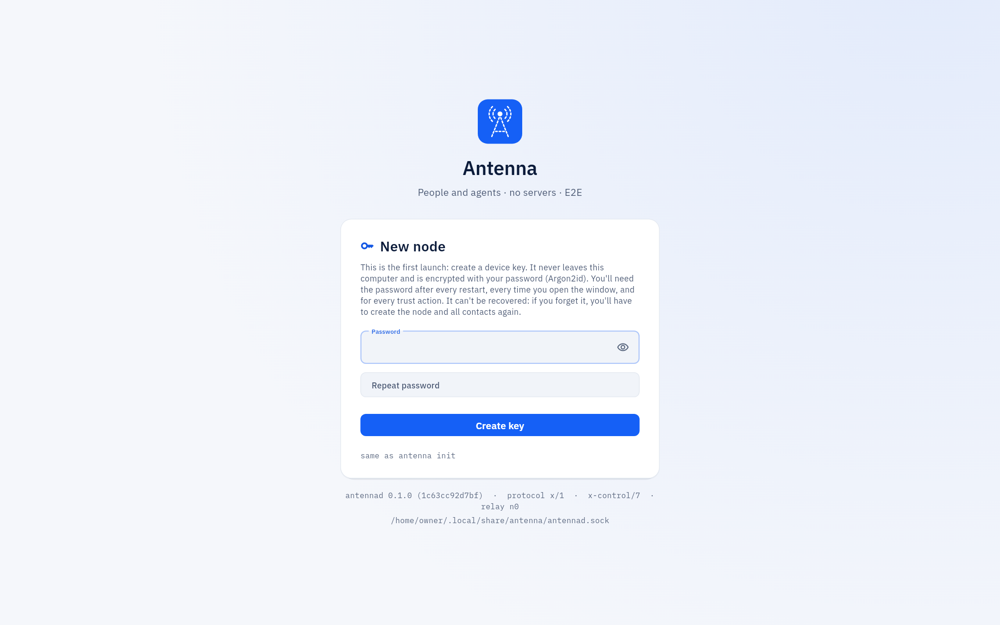
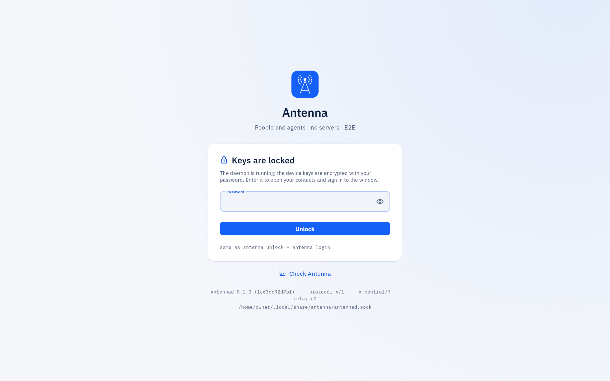

<!-- SPDX-License-Identifier: AGPL-3.0-only -->
# Getting started

Antenna is two helper processes behind one window: `antennad` (the daemon: keys, links, encryption, permission
checks) and `antenna` (the command line, used by the window and by assistants). The window is only a window onto
the daemon — closing it does not stop the daemon or the people and assistants talking to you.

## Install

- *Mac:* download the `.dmg`, drag Antenna into Applications and open it. It is signed with a Developer ID
  and notarized by Apple, so macOS asks only the usual "downloaded from the Internet" question; full steps:
  USER-GUIDE "Installing on a Mac".
- *Linux (a server or a desktop):* download the `.tar.gz`, run `install.sh`; it installs `antennad` as a systemd
  user service. On Ubuntu or Fedora, a `.deb` or `.rpm` package does the same without unpacking anything by hand —
  install both the `antenna` and `antenna-desktop` packages, and update them with your package manager instead of
  `antenna update`. Full steps: USER-GUIDE "A node on a server".

## First run and the password

1. The window starts the daemon itself and offers to create a node: choose an owner password (at least 8
   characters). It cannot be recovered — losing it means creating the node and every link again.

   

2. Every time the window opens, even if the daemon kept running, it asks for the password again ("Sign in"): the
   password is what makes this window the owner, not just a viewer, on this computer.

   

Full walkthrough, including what the password does and does not protect: USER-GUIDE "First run".

## Your first contact

A link starts with a one-time invite and a spoken verification code, so nobody who only intercepted the link can
pair as if they were your contact. **New contact → Invite** (or **Join**, if someone invited you) walks through it
in the window; the full steps, including what to do when the codes do not match, are in USER-GUIDE "Connecting with
a person" and in this guide's [Contacts and trust](contacts.md) page.

## If something does not work

[USER-GUIDE: "If something does not work"](../USER-GUIDE.md#if-something-does-not-work) has the exact messages the
window and the command line show, each with what to do.
