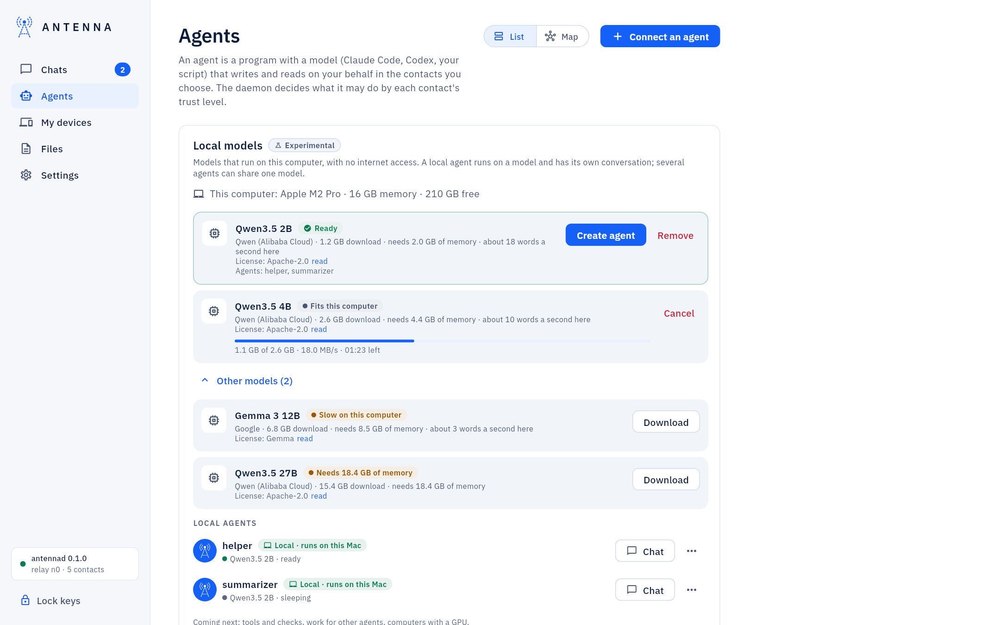
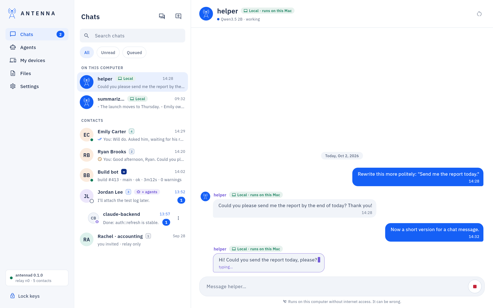

<!-- SPDX-License-Identifier: AGPL-3.0-only -->
# Local models

*Experimental.* Antenna can run an open model on this computer — no account, no API key, no internet once the model
is downloaded. A local model is an agent of yours with its own chat; for now it only talks with you.

*Where it is.* **Agents → Local models**; each local agent's conversation appears under **On this computer** in
**Chats**.

## Download a model and create an agent

1. **Local models** shows this computer's memory and free space, and the model **Recommended for this computer**
   (Qwen3.5 2B for 8 GB machines, 4B for 16 GB Intel/AMD and M1 Macs, 9B for M2-and-later Macs with 16 GB or more);
   "Other models", with a count, lists the rest, each marked **Fits this computer**, **Slow on this computer** or
   **Not for this computer**.
2. **Download** fetches the file from Hugging Face at a fixed version, and checks it against the size and SHA-256
   Antenna carries before ever loading it; a mismatch is deleted. **Checking the file…** shows while that runs;
   **Try again** after a failure.
3. **Create agent** names it (your password once). Several agents can share one model, and models of several sizes
   can run side by side.

## The chat

Write to it like any contact; the first reply waits while the model loads ("Loading the model…"), or while another
model frees the memory it needs ("Waiting for memory…"). **Stop** ends an answer; **New conversation** deletes the
old one. The agent carries the **Local · runs on this Mac** mark everywhere it is named.

**Remove** deletes the model file; its agents stay and work again once it is downloaded again.

## What protects you

The model runs in its own sandbox (its model file only, no network, no files); the agent's own program runs in a
second sandbox that can reach only the model. A local agent has no links and no tools in this version: it cannot send
anything to anyone, and it can still be wrong.

Full detail, including memory and disk sizes per model and the command-line equivalents (`antenna local models`,
`antenna local install`, `antenna local add`): [USER-GUIDE: "Local models"](../USER-GUIDE.md#local-models).
