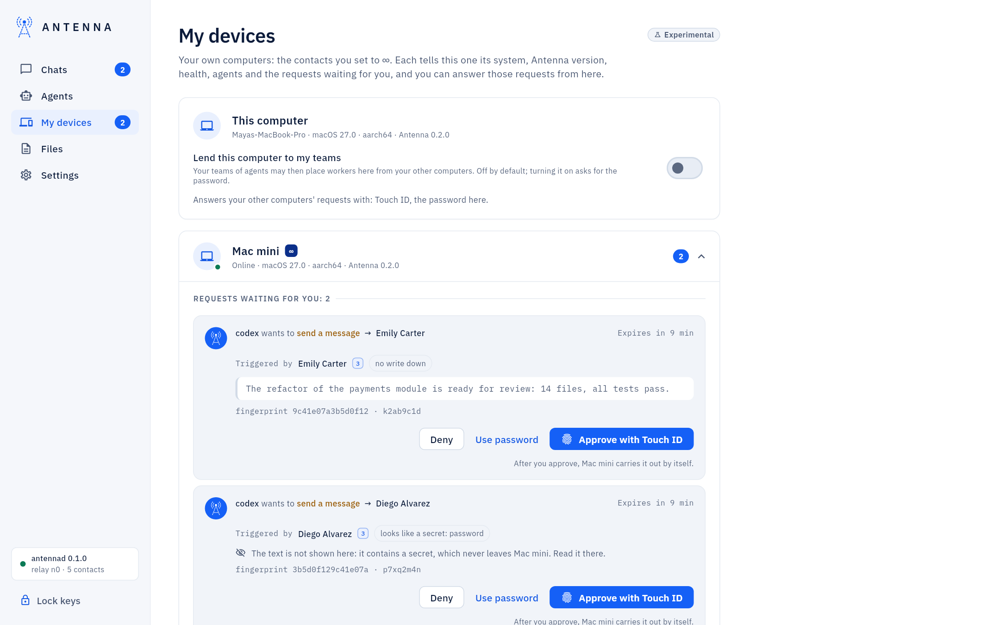
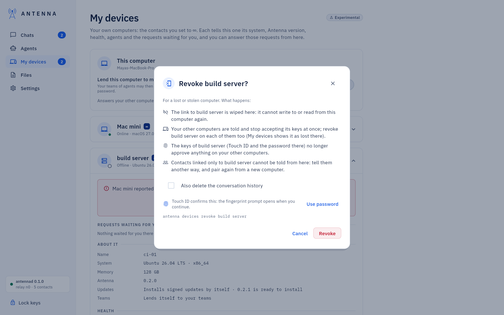

<!-- SPDX-License-Identifier: AGPL-3.0-only -->
# My devices

*Where it is.* The left navigation's **My devices** item, between **Agents** and **Files**; its counter is the number of
requests waiting for you on your other computers. Experimental.

Your own computers are the contacts you set to ∞ (*My computer*): pair one with **This is my own computer (∞)** ticked
([Contacts and trust](contacts.md)). Each tells the others what it is, over the end-to-end encrypted link between them,
when something changes and at least once a minute: its system, Antenna version and updates, health, agents, and the
requests waiting for your approval. Both computers need Antenna 0.1.0 or later and each must have the other at ∞.
Adding a server this way, step by step: [Add a server and its agents](add-a-server.md).

## This computer

The first card: this computer's name, system and version, and **Lend this computer to my teams**: off by default;
turning it on asks for the password. Your teams of agents read it: a team lists the computers that lend themselves among
its machines (workers on another computer come with a later version). The last line says which keys this computer
answers your other computers' requests with: *Touch ID* (when it is on in **Settings → Security**) and *the password
here*.

## Each of your computers

One card per computer, folded to a line (online or when it was last heard, system, version) until something needs you:
a request, a problem, a key to accept, or a report that it is lost. Inside, from the top:

- *Requests waiting for you*: what an agent there asks, for whom, why, and its text, except a text with a secret in
  it: that never leaves the computer that asked, and the card says so. **Approve with Touch ID** (one touch),
  **Use password** or **Approve with password** (the password of *this* computer), **Deny** (nothing to type). The
  computer that asked decides: it checks the signature against the keys you accepted there, its own one-time challenge and this
  exact request; then it carries the request out itself, as after an approval at that computer.
- **About it**: name, system, memory, Antenna version, whether it installs signed updates by itself (and an update
  ready or done), whether it lends itself to your teams.
- **Health**: the problems its own checks see (a relay it cannot reach, an agent token held by another app, a failed
  automatic update), as `antenna doctor` there would say.
- **Agents**: each agent there, the program it runs as and whether it is connected, with a stop button
  ([below](#stop-an-agent-on-another-computer)).
- **Approvals**: which of its keys this computer accepts, and which of this computer's it accepts.

Only approve and deny travel between your computers. Nothing else you can do at a computer (trust, invites, updates,
settings) can be done from another one.

## Stop an agent on another computer

*Experimental.* **My devices** → the computer's card → **Agents** → the stop button next to an agent (**Stop agent and
its processes…**): after you confirm, that computer stops the agent and every process it started, as [Code
mode](code-mode.md#stop-an-agent-and-everything-it-started) does there, and the notice says what it took ("Stopped codex
on Mac mini: 2 processes"). No password: stopping only makes things safer. A tab of that agent in Code mode there says it
was stopped from this computer. The button is off ("Needs a newer Antenna on Mac mini") when that computer's Antenna
cannot do it.

## Accepting approvals from another computer

A computer answers another's requests only with keys you accepted there, once, with the password. On the computer that
will be asked: **My devices** → the card of the computer you will approve from → **Approvals** → *Accept approvals
signed with …* → the password. Turning Touch ID on there later makes a new key, which you accept the same way. **Stop
accepting** removes them (no password). Lowering a computer below ∞ removes its keys; raising it back does not bring
them back.

From a terminal: `antenna devices` lists your computers and their requests; `antenna devices confirm <computer>`,
`antenna devices approve <computer> <id>`, `antenna devices deny <computer> <id>`.

## A lost or stolen computer

On any of your other computers: its card → **Revoke this computer** → the password. What happens:

- the link to it is wiped there: it cannot write to or read from that computer again (the history stays, unless you
  tick **Also delete the conversation history**);
- your other computers are told and stop accepting its keys at once; they show it as reported lost, with
  **Revoke this computer** and **It is not lost**: revoke it on each of them too;
- contacts linked only to the lost computer cannot be told from here: tell them another way, and pair again from a new
  computer.

The keys on the lost computer itself stay locked under its password (and, for Touch ID, in its Secure Enclave). More:
[How to…: a lost or stolen computer](how-to.md#handle-a-lost-or-stolen-computer).
