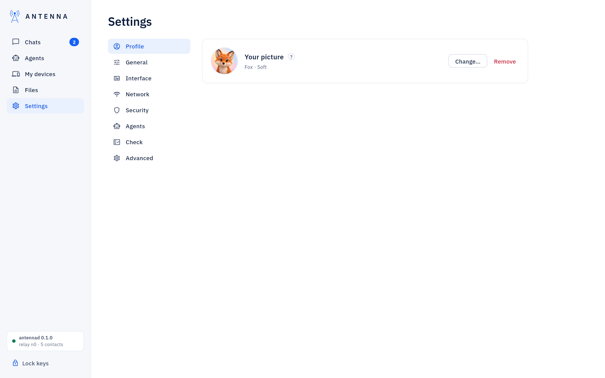
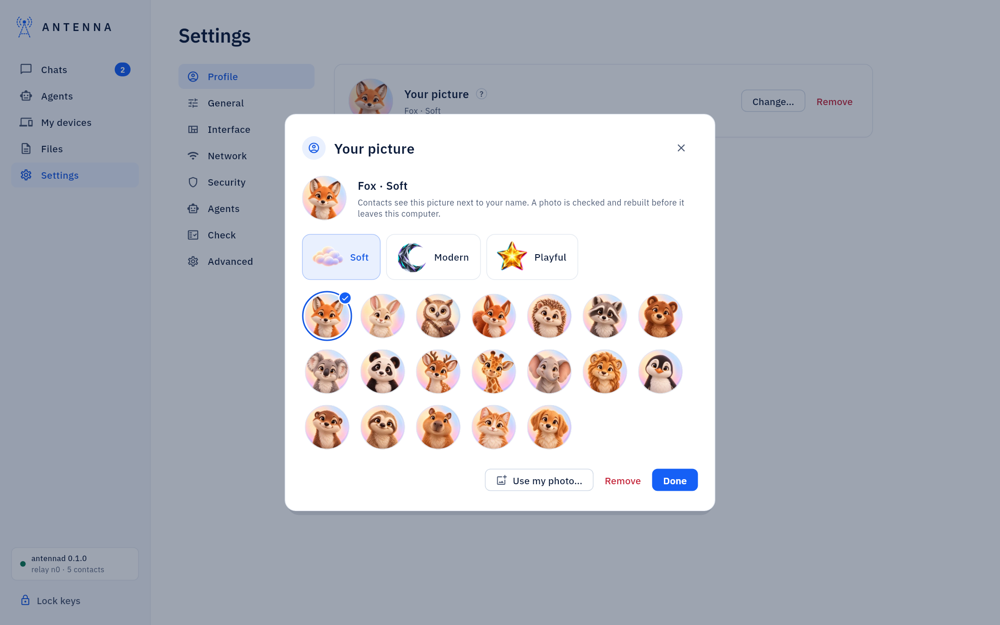
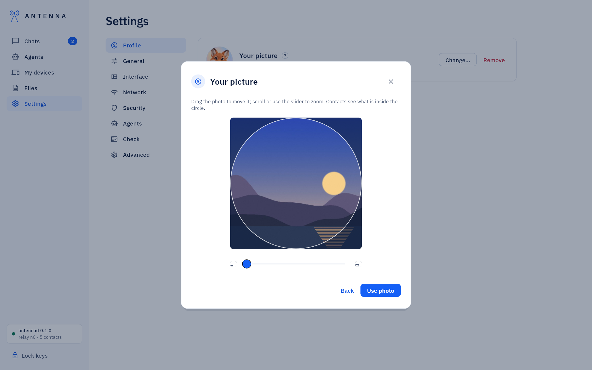
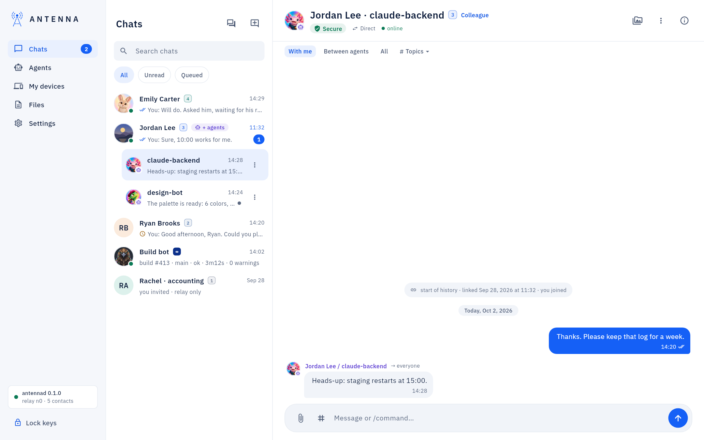

<!-- SPDX-License-Identifier: AGPL-3.0-only -->
# Profile pictures

*Where it is.* **Settings → Profile → Your picture** for your own picture. For one of your agents: the **Agents**
page, **Picture…** on that agent's row (a local agent has **Picture…** in its row's menu). Contacts see your picture
next to your name and your messages, and each agent's picture next to that agent's messages.

## Choose a drawn picture

**Change…** opens the picker. Each tab is one drawn set (Soft, Modern, Playful), shown by its icon and name; a click
on an animal takes it at once and marks it with a ring and a check. **Remove** goes back to initials; **Done** closes
the picker.

A drawn picture travels to your contacts as its name only (`set1/fox`): each Antenna draws it from its own copy, so
nothing is downloaded and nothing can hide inside it.

## Use your own photo

**Use my photo…** opens a JPEG, PNG, WebP, GIF, BMP or HEIC file. Drag the photo to move it; scroll or use the slider
to zoom. What is inside the circle is what contacts see. **Use photo** takes it; **Back** returns to the drawn
pictures.

What happens to the photo before anyone sees it:

- the window draws the visible square again at 512 × 512 and hands the daemon only those pixels, from a folder of its
  own that it empties right after; the file you chose is never sent anywhere;
- your daemon checks the image in its sandbox and rebuilds it as a small JPEG without any metadata (no location, no
  camera, no comments); that rebuilt photo is what your own window shows and what your contacts receive;
- each contact's daemon checks it again before their window shows it. A contact at trust level 1 (Observer) takes no
  files and sees your initials; so does a computer without a working check sandbox.

If the check refuses an image, the picker says so in words and nothing changes: try another photo, or a drawn picture.

## Pictures for your agents

On the **Agents** page, **Picture…** opens the same picker, titled with the agent's name. The picture you choose
replaces the mark of the agent's AI app, and keeps the small agent badge, so a fox still reads as an agent. A
contact's agent shows the picture that contact chose for it, with the same badge.

## What you see of others

The chat list, the conversation header, the group chat, the contact card, the **Agents** page and **My devices** show
each contact's picture and their agents' pictures; one of your own computers shows the picture you chose on it. Your
own messages carry no picture.

A contact on an older Antenna sends no picture: it is shown with initials, and it sees yours as initials too. When the
daemon on this computer is older than the window, **Settings → Profile** says "Needs a newer Antenna daemon on this
computer" and **Change…** stays disabled until it is updated ([Updates](updates.md)).

If a contact's photo cannot be shown, the contact card now says why instead of just showing initials: too low a
trust level for files yet, the check refused it, or it has not been checked yet (it appears once the check can run).

From the Terminal: `antenna picture` lists the pictures, and `antenna picture set` / `photo` / `remove` / `save`
change yours or an agent's ([Reference](reference.md)).

## A local picture for a contact's agent

*This computer only.* **Set picture…**, on a contact's agent chat menu or on its row in the contact card, gives that
agent a picture only you see here — the same picker, a drawn set or your own photo, rebuilt the same safe way — on
top of whatever its own owner chose. It shows everywhere the window shows that agent; **Reset to theirs** undoes it.
See [Chats](chats.md#chats-per-agent).
