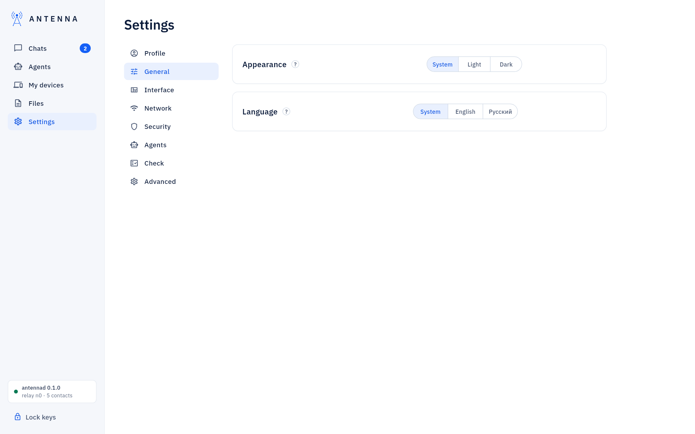
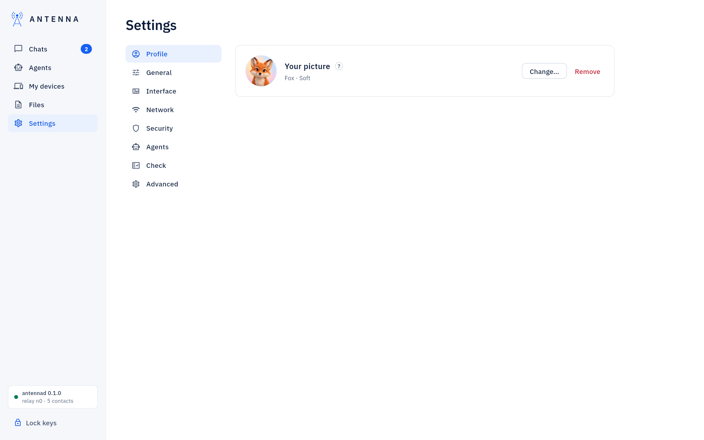
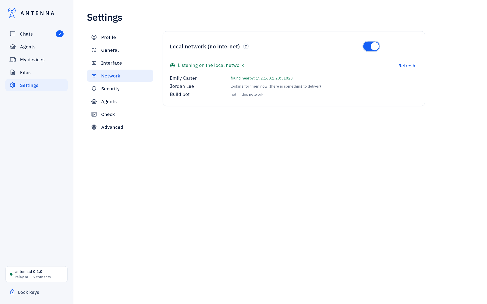
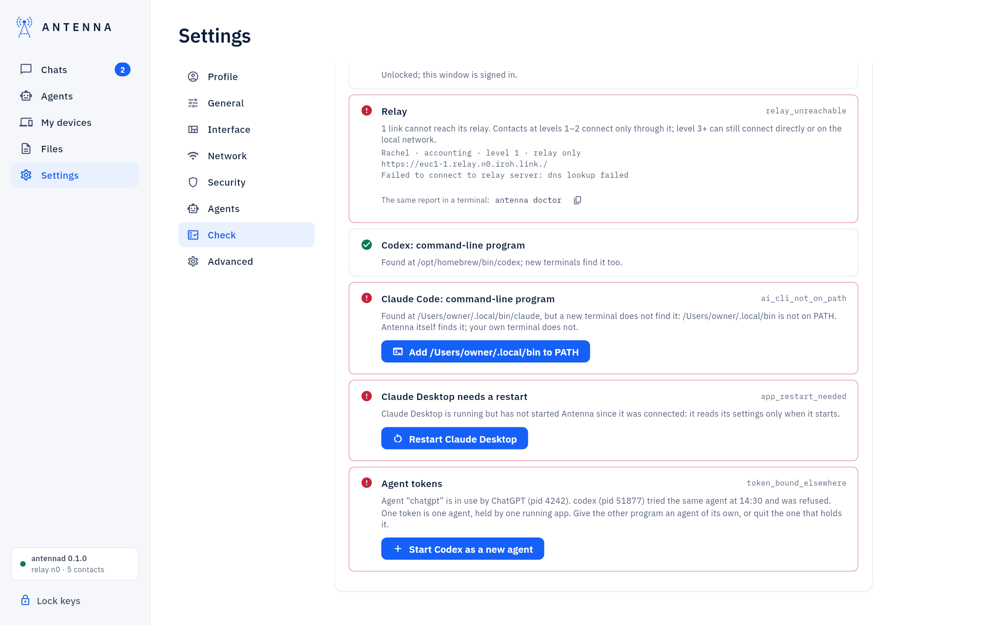
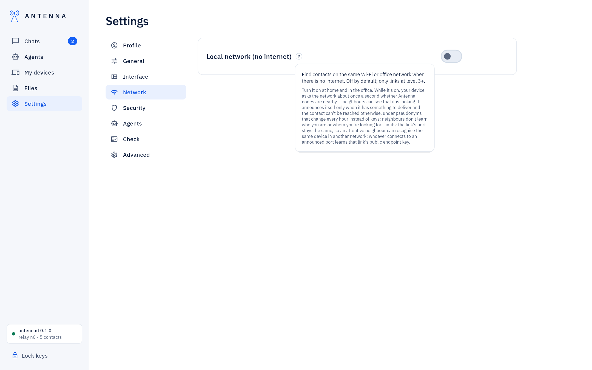

<!-- SPDX-License-Identifier: AGPL-3.0-only -->
# Settings

*Where it is.* The left navigation's **Settings** item, with eight sections down the left side of the page;
Settings opens on the first one, Profile. Every
row has a name, a small `?` with the explanation (hover, click or Tab), and the control — [USER-GUIDE: "Where
things are in the window"](../USER-GUIDE.md#where-things-are-in-the-window) names every row by its exact label.

## Profile

**Your picture**: the picture contacts see next to your name, what it is, **Change…** (the picker of drawn animals and
your own photo) and **Remove**. Full detail: [Profile pictures](profile-pictures.md).

## General

Appearance (System / Light / Dark) and Language (System / English / Russian).

## Interface

**Interface** switches the whole window between the chat layout and [Code mode](code-mode.md) (Chat / Code).

## Network

The local network (LAN) card: devices discovered on the same network without internet, and **Turn on**. Off by
default, and useful only for contacts at trust level 3 and above. Full detail: [USER-GUIDE: "Without internet, on
the same network (LAN)"](../USER-GUIDE.md#without-internet-on-the-same-network-lan).

## Security

**Use Touch ID** (Mac only, experimental) and **Keys**: **Lock keys** (`antenna lock`), which pauses every contact
until you type the password again. Full detail: [Touch ID](touch-id.md).

## Agents

The role preset for new agents, and **Open Agents**, which switches to the [Agents](agents-page.md) page.

## Check

The Check panel: fixed checks with one-click fixes. Full detail: [Check](check.md).

## Advanced

Daemon facts and **Stop daemon**; the **antenna command in the terminal…** button (USER-GUIDE: "The antenna command
in the Terminal"); **Updates**: the per-computer **Install signed updates by itself** switch and its status. Full
detail: [Updates](updates.md).

## Settings help

Hovering, clicking or tabbing to a row's `?` opens its explanation in place.

