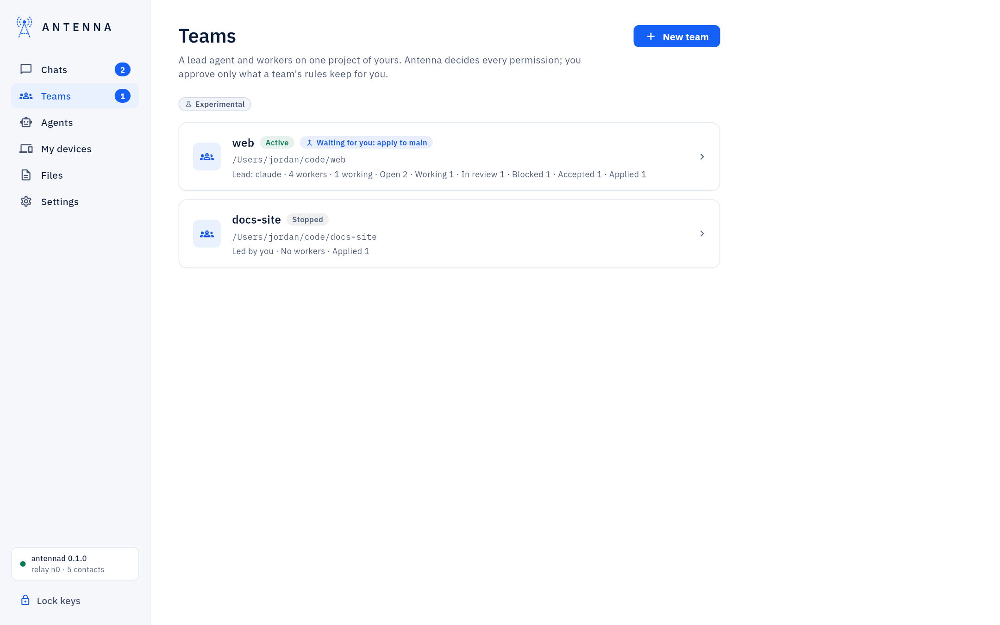
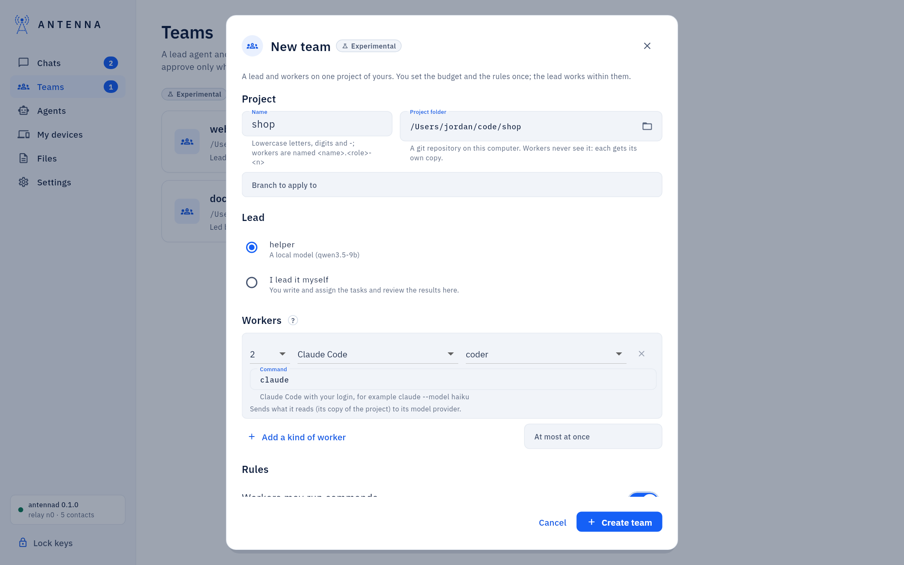
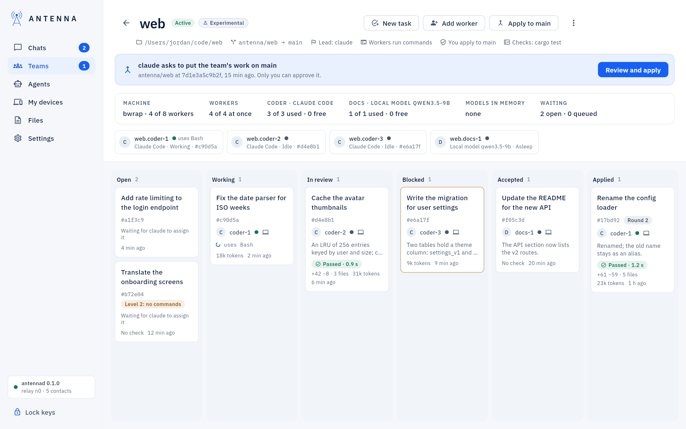
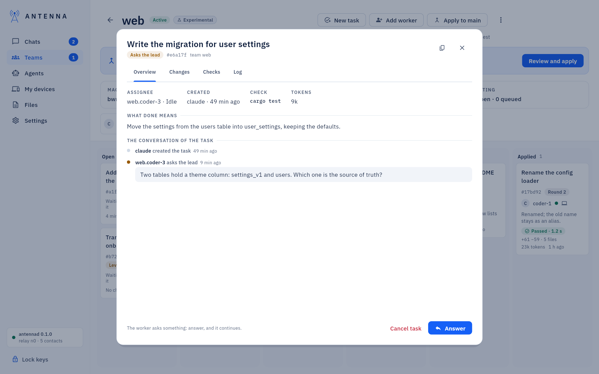
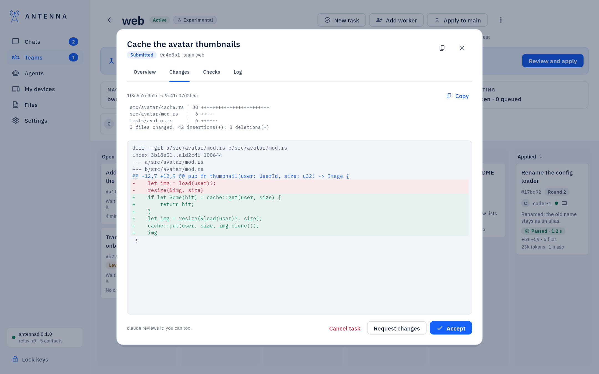
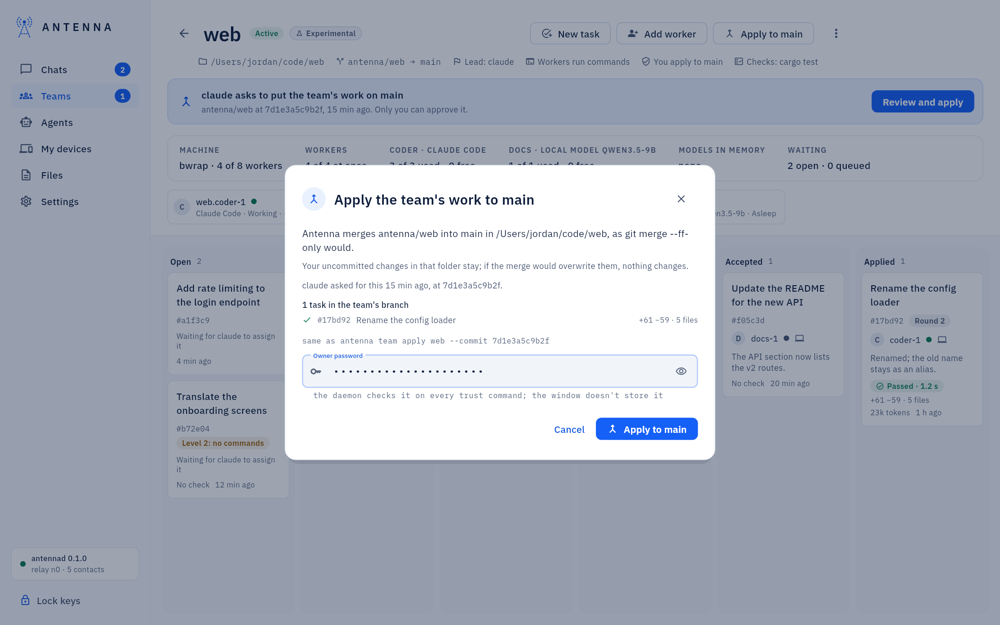
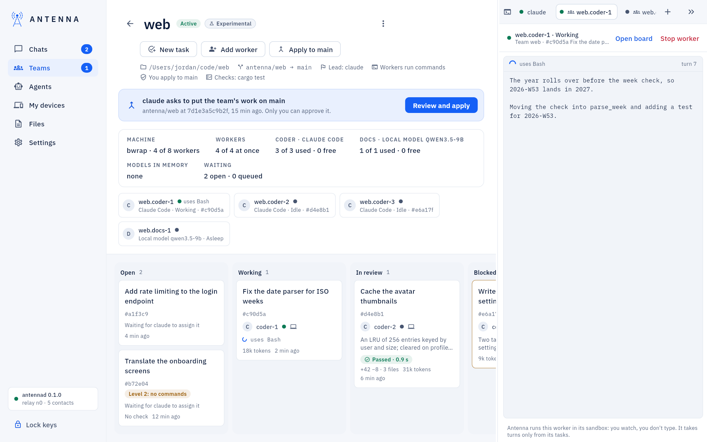

<!-- SPDX-License-Identifier: AGPL-3.0-only -->
# Teams

*Experimental.* A team is a lead agent and workers on one project of yours: the lead splits the work into tasks,
gives each to a worker, checks the results and sends them back or accepts them, the way a coding agent directs its
own helpers. Antenna decides every permission on the way; you set the budget and the rules once and approve only
what they keep for you (by default: putting the team's work on your branch).

*Where it is.* **Teams** in the navigation (it appears when this computer's Antenna has teams). The number on it is
what waits for you: a lead's request to apply, and in a team you lead, results to review and questions to answer.

## Create a team

**Teams → New team** asks for, top to bottom:

- **Project**: a name (lowercase letters, digits and -; workers are named after it, `web.coder-1`), the **Project
  folder** (a git repository on this computer; on a Mac, macOS asks once whether Antenna may open it) and, if you
  like, the branch to apply to (otherwise the one checked out now). Workers never see this folder: each gets its own
  copy.
- **Lead**: one of your agents (an agent running in Code mode here is woken when a task needs it; another agent gets
  the team tools when its app restarts), a local model, or **I lead it myself**.
- **Workers**: the budget, one line per kind of worker ("up to 2 Claude Code coders"): how many, which program
  (Claude Code with your login, another program that speaks Claude Code's stream-json, or a local model), and the
  role. **Add a kind of worker** adds a line. The lead creates workers only within these lines.
- **Rules**: **Workers may run commands**; the **Check commands** tasks may name (`cargo test`);
  the **Registries checks may reach** (without any, checks have no network); who puts the team's work on your
  branch (you, or the lead); **Local only** (no cloud model at all); and under **Limits** the time of a turn and of
  a check, the tokens of a task, the automatic returns, and the toolchain folders and variables checks need.
- **Machines**: this computer, and your other computers (trust ∞) with whether each lends itself to your teams:
  that is its own switch, **Lend this computer to my teams**, under **My devices** on that computer. Workers on
  other computers come in a later version.

**Create team** asks for your password once: the budget lets the lead create agents.

## The board

A team's card opens its board: the project, the branches (`antenna/web → main`), the lead and the rules on top; the
lead's request to apply, when there is one; the capacity strip; the workers; and the tasks in columns by state:
Open, Working (with "Returned" on a task that came back), In review, Blocked (the worker asks the lead something),
Accepted and Applied. A card shows the task's title and ID, the round, the level it carries when that limits its
worker, the worker and its state, the last note (the worker's report, or the latest review), the check's outcome,
what the result changes, the tokens and when it last changed; while the worker writes, its current line.

The capacity strip says what the team may use: **Machine** (this computer, its sandbox, the workers of all teams
against its limit), the team's workers at once, each line of the budget used and free (with the reason when one
cannot start now), **Models in memory**, the work **Waiting** (open tasks, queued turns), and **Your other
computers** that lend themselves (listed; no worker runs there yet).

The workers' chips open a worker: what it is, its task, its tokens, its live output (read-only: Antenna runs it, you
watch), and **Stop worker** (no password: it only takes work away).

**New task** writes a task (a title, what done means, one of the team's check commands, and whom to give it to, or
leave it for the lead). **Add worker** adds one within the budget, no password.

## A task

A card opens the task: **Overview** (who works on it, who wrote it, the check, what done means, the worker's live
output while it works, and the conversation of the task: created, the worker's report or question, each review, the
check, applied), **Changes** (what the result changes, from the daemon's commit), **Checks** (the last run in the
check sandbox: the command, the outcome, the output, the hosts the proxy refused) and **Log** (every step Antenna
took for this task).

What you can do follows the task's state, the same as its lead:

- a submitted result: **Accept**, or **Request changes** with a comment (**Send back**);
- a question: **Answer** (**Send answer**): the worker continues with it;
- an accepted result: "Apply to antenna/web" merges it into the team's branch (no password: your branch does not
  move);
- an open task: give it to a free worker (**Assign**);
- any unfinished task: **Cancel task**.

*Experimental.* **Urgent: interrupt the worker now**, next to the comment of **Request changes**, sends your changes so
that the worker's current turn is interrupted and the task returns to it with your comment at once. For a task a worker
has or is working on, turning it on is what offers **Request changes** at all. It is for one request.

A task the lead wrote after reading a contact you trust at level 2 says so ("Level 2: no commands"): its worker runs
no command and no check, so an instruction slipped into that contact's message cannot reach your computer's commands.

## Apply the team's work to your branch

When the lead asks to put the team's branch on yours, the board says so ("claude asks to put the team's work on
main"). **Review and apply** shows what Antenna will merge and where, the tasks in the team's branch (each opens its
changes), and the command line equivalent; "Apply to main" with your password merges `antenna/web` into `main` in the
project folder, as `git merge --ff-only` would. Your uncommitted changes stay; if the merge would overwrite them,
nothing changes. If the team's branch moved since you looked, Antenna refuses and you review again. Without the
password nothing is applied, whatever the lead or the window does.

The same dialog opens from "Apply to main" in the board's header at any time.

## Teams in Code mode

When the lead runs in a Code mode terminal of this window, it gets one built-in line when somebody else changed one of
its tasks (a worker submitted or asks something, the check finished, you reviewed or applied): "Your Antenna team web
has news: check task_list and continue." It follows the wake's rules (only at Claude Code's empty prompt or for its
running turn, one line per 30 seconds, never its own changes, never any text a worker wrote) and the same switch,
"Wake on new messages".

The workers Antenna runs with Claude Code (or another program) appear as tabs after the terminals in the dock: each
shows that worker's output and task, read-only, with **Open board** and **Stop worker**.

## Stop and remove

The board's menu holds **Log** (every step of the team), **Stop all workers** (no password; their folders and tasks
stay), **Make active again** (your password) and **Remove team** (the workers, their folders and the branches of
unapplied tasks go; your project and the team's branch stay).

## What protects you

The daemon decides every call, not the lead: workers run in their own sandboxes with their own copy of the project,
reach only their model provider, never see your folder or each other, and read only their own task; the lead can
create workers only within your budget and cannot change it, approve anything, or see a worker's token; checks run in
a second sandbox with no tokens and no network but the registries you named. The board is a view of the daemon's
records. Full detail and the command line (`antenna team …`, `antenna task …`): [USER-GUIDE: "Teams of
agents"](../USER-GUIDE.md#teams-of-agents).
