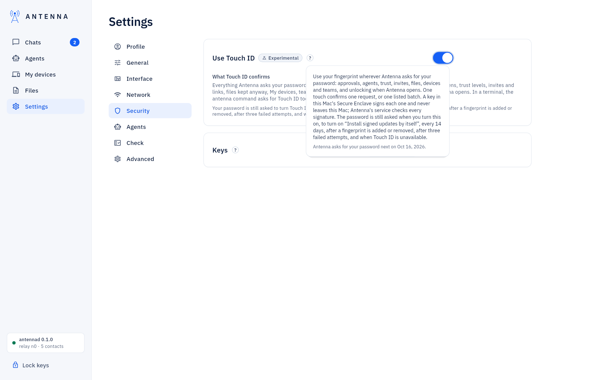
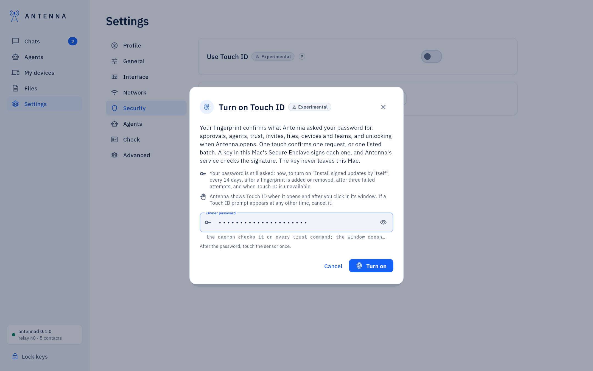
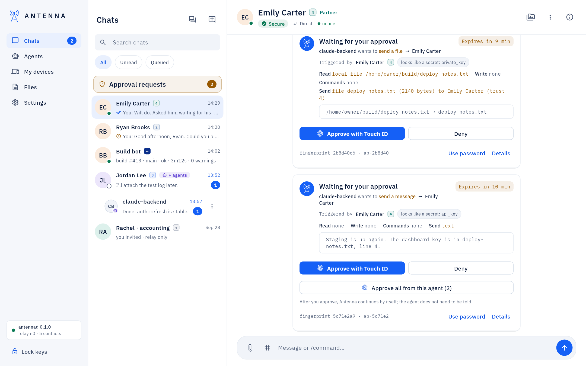
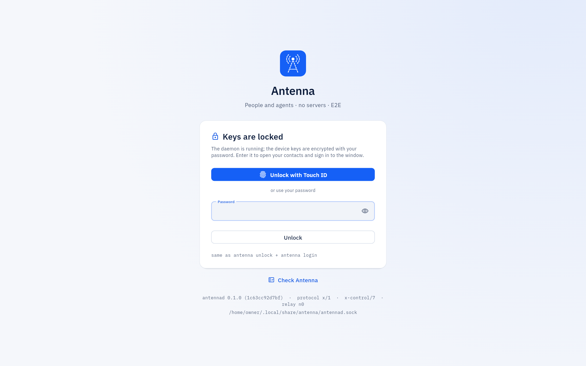

<!-- SPDX-License-Identifier: AGPL-3.0-only -->
# Touch ID

*Experimental, on a Mac with Touch ID.* Once it is on, one touch stands in for the password wherever Antenna asked for
it: approvals (one request, or a listed batch), starting and connecting agents, trust levels, invites, files kept
anyway, My devices, teams and approvers, and unlocking when Antenna opens. The key lives in this Mac's Secure Enclave and
never leaves it.

*Where it is.* **Settings → Security → Use Touch ID** turns it on, after one password entry and one touch.

## Where it is used

With Touch ID on, an approval offers a fingerprint prompt alongside **Use password**. Any other action that asked for
the password opens the Touch ID sheet when you click it, and a form that had a password field shows a Touch ID line
with **Use password** next to it. When Antenna opens with its keys locked, the sheet appears by itself once; after
**Lock keys** the window offers **Unlock with Touch ID**, and a window that only needs to sign in offers **Sign in with
Touch ID**. **Settings → Security** lists what Touch ID confirms. In the Terminal, `antenna` commands ask for Touch ID
too; scripts with `--password-stdin` keep the password.

*The password is still asked* when you turn Touch ID on, to turn on **Install signed updates by itself**, every 14
days, after a fingerprint is added or removed in System Settings, after three failed attempts, and whenever Touch ID
itself is unavailable. Cancelling the sheet asks for the password; it never confirms anything. Full detail, including
what a genuine Antenna Touch ID prompt always looks like: [USER-GUIDE: "Approve with Touch
ID"](../USER-GUIDE.md#approve-with-touch-id).

## If something does not work

A Touch ID prompt asking for the password instead, or one that appears without your click: [USER-GUIDE: "If
something does not work"](../USER-GUIDE.md#if-something-does-not-work).
