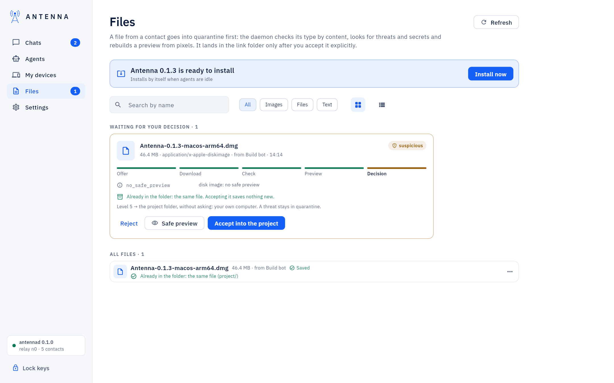
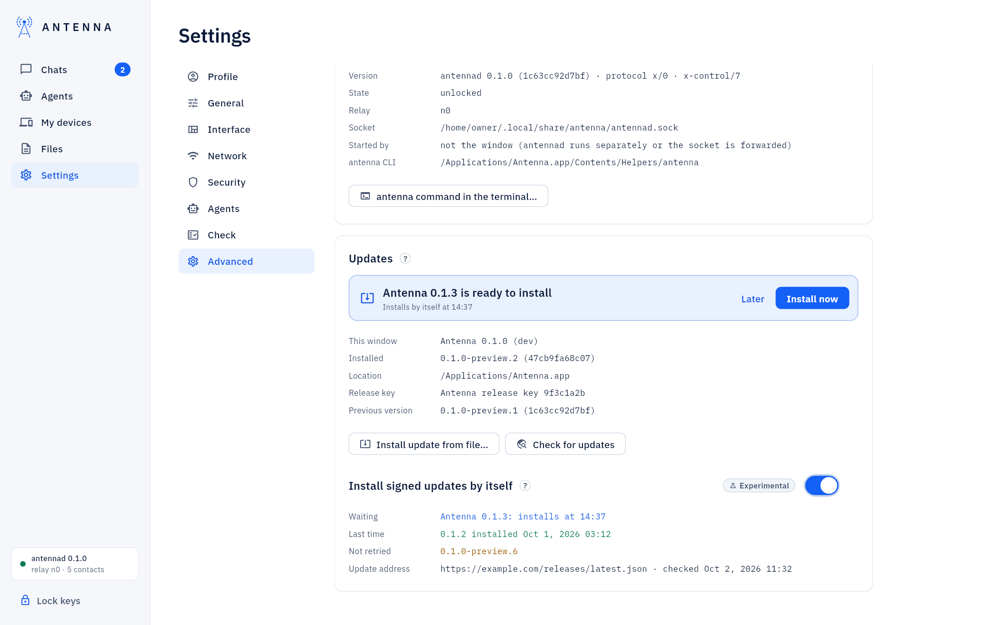

<!-- SPDX-License-Identifier: AGPL-3.0-only -->
# Updates

An installed Antenna updates itself only from a signed release: a manifest and its signature, checked against the
release key built into Antenna, so no one can forge one.

*Where it is.* **Settings → Advanced → Updates**.

## Installing a release

**Settings → Updates → Install update from file…** → choose the folder with the manifest, its signature and the
platform file → **Install and restart** (your password). The same from the Terminal: `antenna update --from
<folder>`.

A release a contact sent you arrives like any file: once accepted, its card and a banner both show **Install**.

*Installed from a `.deb` or `.rpm` package (Linux)?* `antenna update` refuses and says so: update with your package
manager (`apt`/`dpkg` or `dnf`/`rpm`) instead — it is the one that installed the files, so it is the one that
replaces them.

Full walkthrough, including rolling back: [USER-GUIDE: "Updating Antenna"](../USER-GUIDE.md#updating-antenna).

## Installing by itself

*Experimental.* **Install signed updates by itself**, turned on separately on each of your own computers, installs
a signed, newer release once your agents have been idle for 10 minutes, and comes back with the keys unlocked. It
only ever installs what a manual update would also accept.

`antenna update --auto status` / `now` / `later` do the same from the Terminal. Full detail, including where the
keys go during the restart and what happens on a crash: [USER-GUIDE: "Updates that install by
themselves"](../USER-GUIDE.md#updates-that-install-by-themselves).

## If something does not work

`no_release_key`, `bad_signature`, `not_newer`, `locked` or `daemon_unavailable`: [USER-GUIDE: "If something does not
work"](../USER-GUIDE.md#if-something-does-not-work).
